# Libreto de la presentación — Banco Plus (borrador v1)

> Borrador para ajustar a tu voz. Diez diapositivas, veinte minutos. Cada diapositiva tiene título,
> contenido, diagrama (descrito en palabras y dibujado en Mermaid, para pasarlo a las diapositivas),
> guion y preguntas probables de la mesa.
> **No hay cifras de ahorro propias**: no conocemos las métricas de Banco Plus. El −30% es la meta del caso;
> la cifra real sale de un estudio previo de la línea base. Solo se citan números públicos con fuente.

---

## Diapositiva 1 — Portada y la historia (1,5 min)

**Título:** Del SLO al post-mortem: confiabilidad medible para el pago QR de Banco Plus.

**Contenido:**
- Una sola historia, no cuatro proyectos: cada eje alimenta al siguiente.
- El cliente define qué es "funcionar": SLO (Service Level Objective) del pago QR.
- El pipeline protege el SLO; la telemetría lo explica; la IA acelera el diagnóstico; las personas aprenden.
- Éxito medido con DORA (DevOps Research and Assessment): Change Failure Rate < 15% y Time to Restore < 1 h.
- Telemetría: meta del caso −30% de costo, sin perder ninguna traza de error.

**Diagrama:** un ciclo de cuatro pasos. Uno, SLO del pago QR con su Error Budget. Dos, Quality Gate en
CI/CD que frena despliegues malos. Tres, OpenTelemetry Collector y MCP, que dan datos limpios, baratos y
sin PII para la IA causal. Cuatro, Incident Commander y post-mortem blameless. Una flecha vuelve del
paso cuatro al paso uno: "acciones → SLOs y alertas mejores".

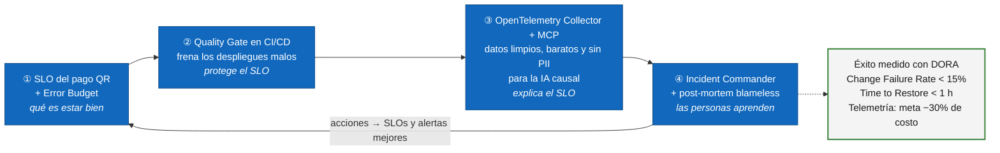

**Guion:**
"Buenos días. Hoy les traigo una sola historia: cómo hacer que el pago con QR de Banco Plus sea
confiable de forma medible. Los cuatro retos del caso (despliegues que degradan producción, una factura
de telemetría que crece sin dar visibilidad, un MTTR (Mean Time To Restore) largo y la ambición de
AIOps) no son cuatro problemas: son síntomas de uno solo. No tenemos una definición compartida de qué
es 'estar bien' ni datos estandarizados para saber cuándo dejamos de estarlo.
Por eso la propuesta es un ciclo. Primero, el SLO del pago QR define qué es estar bien, desde el
cliente y no desde la CPU. Segundo, ese SLO y su Error Budget se convierten en un Quality Gate en el
CI/CD (Continuous Integration / Continuous Delivery) que frena solo los despliegues peligrosos. Tercero,
el OpenTelemetry Collector entrega datos limpios, sin PII (Personally Identifiable Information),
muestreados con inteligencia y más baratos; sobre esos datos, con Semantic Conventions y MCP (Model
Context Protocol), la IA propone la causa raíz. Cuarto, el Incident Commander usa todo eso en la crisis,
y el post-mortem blameless devuelve acciones que mejoran los SLOs. Ahí se cierra el ciclo.
¿Cómo sabremos que funcionó? Con métricas DORA: Change Failure Rate por debajo del 15%, Time to Restore
por debajo de una hora, y la meta de −30% en el costo de telemetría, medida contra una línea base real. En mi experiencia anterior, en una plataforma
de comercio electrónico de alto volumen, implementé rollback automático por alertas durante canary y un
servidor MCP de observabilidad. Lo que les voy a mostrar es ejecutable, no solo teórico."

**Preguntas probables:**
1. *¿Por qué empezar por los SLOs y no por las herramientas?* — Sin SLO no hay criterio: el Quality
   Gate no sabe cuándo frenar, el sampling no sabe qué traza es importante y el Incident Commander no
   sabe qué tan grave es el incidente. Las herramientas se reemplazan; la definición de "estar bien" no.
2. *Esto suena a dos años de programa. ¿Qué entregas en 90 días?* — Se responde con la hoja de ruta de
   la diapositiva 10: un servicio (pago QR), tres entregas medibles a 30, 60 y 90 días.

---

## Diapositiva 2 — Contexto: Banco Plus en un diagrama C4 Context (1,5 min)

**Título:** El problema: cuatro síntomas, una sola causa.

**Contenido:**
- Pago QR y transferencias en tiempo real sobre microservicios en Kubernetes, en AWS y GCP.
- El core bancario (AS400) se alcanza por IBM MQ: la traza hoy se corta ahí.
- Despliegues sin freno → Change Failure Rate alto.
- Telemetría sin estándar → factura alta y MTTR largo.
- Los 4 ejes atacan la causa común: falta de un "estar bien" medible y de datos estandarizados.

**Diagrama (C4 nivel 1, Context):** en el centro, la caja "Plataforma de pagos de Banco Plus
(microservicios en Kubernetes, AWS + GCP)". Alrededor:
- Actor "Cliente en la app móvil" → paga con QR.
- Actor "Comercio" → recibe la confirmación.
- Sistema externo "Core bancario AS400" ← vía IBM MQ.
- Sistema externo "Sistema de pagos inmediatos / otros bancos" (Bre-B).
- Sistema "Plataforma de observabilidad" (Mimir, Tempo, Loki y Grafana) ← recibe telemetría.
- Actores internos "Tribus de desarrollo" (despliegan por CI/CD) e "Incident Commander / on-call".
Debajo, una franja con cuatro etiquetas: reto 1 → Eje 1, reto 2 → Eje 2, reto 3 (MTTR) → Eje 3 + Eje 4,
reto 4 (AIOps) → Eje 3.

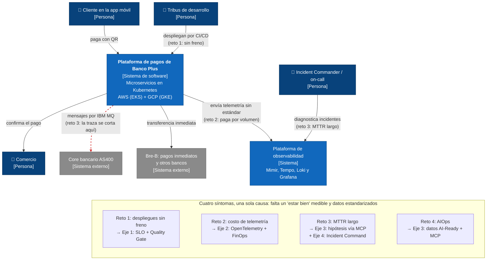

**Guion:**
"Este es Banco Plus en un diagrama C4 de nivel Context: qué sistema construimos y con quién habla. El
cliente paga con QR desde la app; el pago recorre microservicios en Kubernetes, repartidos entre AWS y
GCP; para mover la plata se habla con el core bancario en AS400 por IBM MQ, y con el sistema de pagos
inmediatos y otros bancos.
Los cuatro retos del caso se ven aquí. Uno: las tribus despliegan por CI/CD sin freno, y eso en DORA se
llama un Change Failure Rate alto. Dos: cada componente emite telemetría a su manera y la mandamos toda,
sin filtro, a la plataforma de observabilidad; pagamos por volumen, no por valor. Tres: cuando algo
falla, la traza se corta justo en la frontera con MQ y el AS400, y cada equipo nombra los datos distinto,
así que el MTTR es largo. Cuatro: queremos IA, pero la IA no puede razonar sobre datos desordenados.
La causa común es que no tenemos un 'estar bien' medible ni datos estandarizados. Los cuatro ejes que
siguen atacan esa causa en orden: primero la definición, después los datos, después la inteligencia y,
por último, las personas."

**Preguntas probables:**
1. *El caso habla de CBU. ¿Lo tuviste en cuenta?* — "CBU es un término argentino; en Colombia el
   equivalente de pagos inmediatos es Bre-B, del Banco de la República. El diseño aplica igual: es una
   dependencia externa más en el grafo, con su propio SLI de latencia."
2. *¿Por qué no incluyes el nivel Component del C4?* — "Para una mesa de decisión bastan Context y
   Container; el detalle de componentes lo dibuja cada tribu en su repositorio, como arquitectura como
   código."

---

## Diapositiva 3 — Eje 1: SLIs, SLOs y Error Budget del pago QR (2 min)

**Título:** Qué es "estar bien" para el cliente que paga con QR.

**Contenido:**
- SLI de disponibilidad: pagos aceptados sin error de sistema ÷ pagos válidos. SLO 99,9% en 30 días
  móviles = Error Budget de 43,2 min/mes.
- SLI de latencia: 99% de los pagos confirmados en < 2 s, medido en el API Gateway (percentil, nunca
  promedio).
- Corrección: cero cobros dobles (idempotency key). Saturación como alerta temprana, no como SLO.
- Golden Signals (Latency, Traffic, Errors, Saturation) medidas donde las vive el cliente.
- Error Budget Policy firmada con negocio: > 50% normal · 25–50% solo canary · < 25% congelado salvo
  arreglos de confiabilidad.

**Diagrama:** una barra horizontal del Error Budget mensual (43,2 min) con tres zonas de color: verde
(más del 50% restante, "despliegue normal"), amarillo (25–50%, "solo canary"), rojo (menos del 25%,
"congelado salvo fixes"). Al lado, un recuadro: "Dependencias en serie: 3 × 99,9% = 99,7%".

```mermaid
flowchart LR
    subgraph eb["Error Budget mensual: 43,2 min (SLO 99,9% en 30 días móviles)"]
        direction LR
        verde["🟢 Más del 50% restante<br/>más de 21,6 min<br/><b>Despliegue normal</b>"]
        amarillo["🟡 Entre 25% y 50%<br/>de 10,8 a 21,6 min<br/><b>Solo canary</b>"]
        rojo["🔴 Menos del 25%<br/>menos de 10,8 min<br/><b>Congelado salvo<br/>arreglos de confiabilidad</b>"]
        verde -- "se gasta" --> amarillo -- "se gasta" --> rojo
    end

    subgraph serie["Dependencias en serie"]
        direction LR
        s1["Servicio A<br/>99,9%"] --> s2["Servicio B<br/>99,9%"] --> s3["Servicio C<br/>99,9%"] --> total["0,999³ ≈ <b>99,7%</b>"]
    end

    politica["Error Budget Policy<br/>firmada con negocio"] -.-> eb
    eb ~~~ serie

    classDef ok fill:#2e7d32,stroke:#1b5e20,color:#ffffff
    classDef warn fill:#f9a825,stroke:#c17900,color:#1b1b1b
    classDef bad fill:#c62828,stroke:#8e0000,color:#ffffff
    classDef nota fill:#f4f4f4,stroke:#6b6b6b,color:#1b1b1b
    class verde ok
    class amarillo warn
    class rojo bad
    class s1,s2,s3,total,politica nota
```

**Guion:**
"Empiezo por el cliente, no por el servidor. Al cliente que paga con QR le importan tres cosas: que el
pago salga, que salga rápido y que no le cobren dos veces. Eso se traduce en SLIs (Service Level
Indicators).
El primer SLI es disponibilidad: pagos aceptados sin error de sistema sobre pagos válidos. Ojo con
'válidos': un saldo insuficiente no es culpa nuestra y no cuenta. El SLO es 99,9% en una ventana móvil
de 30 días. Eso nos da un Error Budget de 43,2 minutos al mes.
El segundo SLI es latencia: el 99% de los pagos confirmados en menos de 2 segundos, medido en el API
Gateway, que es lo más cerca del cliente que tenemos. Siempre en percentil, nunca en promedio, porque
el promedio esconde al cliente que esperó 10 segundos.
Las Golden Signals (latencia, tráfico, errores y saturación) cubren el resto: la saturación la usamos
como alerta temprana, no como SLO, porque el cliente no ve la CPU.
Y lo más importante de esta diapositiva no es el número: es la Error Budget Policy. Es un acuerdo
firmado con negocio: con más de la mitad del presupuesto, se despliega normal; entre 25 y 50%, solo
con canary; por debajo de 25%, se congela todo menos los arreglos de confiabilidad. Sin esa política,
el Error Budget es un número en un dashboard. Con la política, el Quality Gate que les muestro ahora
tiene autoridad, y la tiene porque negocio la firmó."

**Preguntas probables:**
1. *¿Por qué no 100% si el pago es crítico?* — Es inalcanzable (el cliente depende de su red, su
   celular y otros bancos), congela la innovación porque cero presupuesto es cero despliegues, y cada
   nueve adicional cuesta exponencialmente más. El SLO correcto es donde el cliente deja de notar la
   diferencia.
2. *El pago QR depende de tres servicios con 99,9% cada uno. ¿Llegas a 99,9%?* — No: en serie se
   multiplican, 0,999³ ≈ 99,7%. Por eso las dependencias críticas necesitan un SLO más exigente o
   redundancia; dos réplicas independientes de 99% en paralelo dan 99,99%.

---

## Diapositiva 4 — Eje 1: Quality Gate autoejecutable en CI/CD (2,5 min)

**Título:** El pipeline frena solo: antes, durante y después del despliegue.

**Contenido:**
- **Antes:** un reusable workflow de GitHub Actions (runners dentro del banco con ARC, credenciales por OIDC) consulta el Error Budget y el burn rate (SLO como
  código con **Sloth** / OpenSLO → reglas de Prometheus); si la política dice "congelado", termina en `exit 1`.
- **Quién controla:** Plataforma publica plantillas por lenguaje con mínimos obligatorios (pruebas,
  seguridad, gate de Error Budget); cada tribu agrega lo que quiera encima. El paso a producción lo aprueba
  una **deployment protection rule** de Plataforma; sin el environment `production`, OIDC no entrega credenciales.
- **Durante:** canary (5% → 25% → 50% → 100%) con Argo Rollouts o, si ya tienen service mesh, Flagger;
  análisis automático contra Prometheus;
  si empeora, rollback automático.
- **Después:** verificación de 30 min del burn rate y registro del evento de cambio.
- Alertas multi-window, multi-burn-rate: 14,4× en 1 h → page · 6× en 6 h → page · 1× en 3 días → ticket.
- Indicador de éxito: Change Failure Rate < 15%.

**Diagrama:** flujo del pipeline de izquierda a derecha: Commit → Build y pruebas → **Gate 1: ¿hay
Error Budget?** (consulta a Prometheus las métricas de Error Budget que genera Sloth; rojo = alto) → Despliegue canary 5% → **Gate 2: análisis
automático** (Prometheus: tasa de error y p99 del canary vs. versión estable; malo = rollback) → 25% →
50% → 100% → **Gate 3: verificación posterior** → evento "cambio desplegado" enviado al catálogo de
cambios (que luego consultará el servidor MCP). Una flecha punteada de excepción: "hotfix de
confiabilidad con aprobación manual y auditoría".

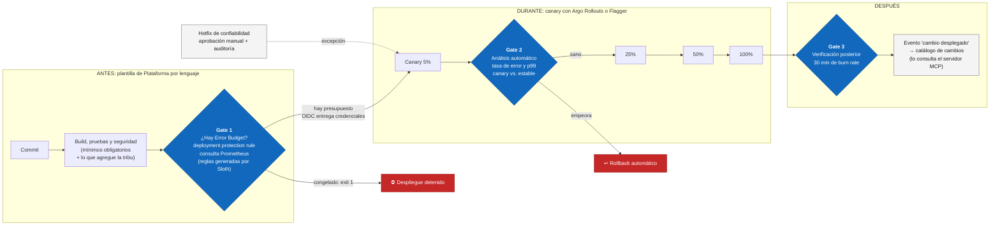

Alertas que acompañan al pipeline (multi-window, multi-burn-rate):

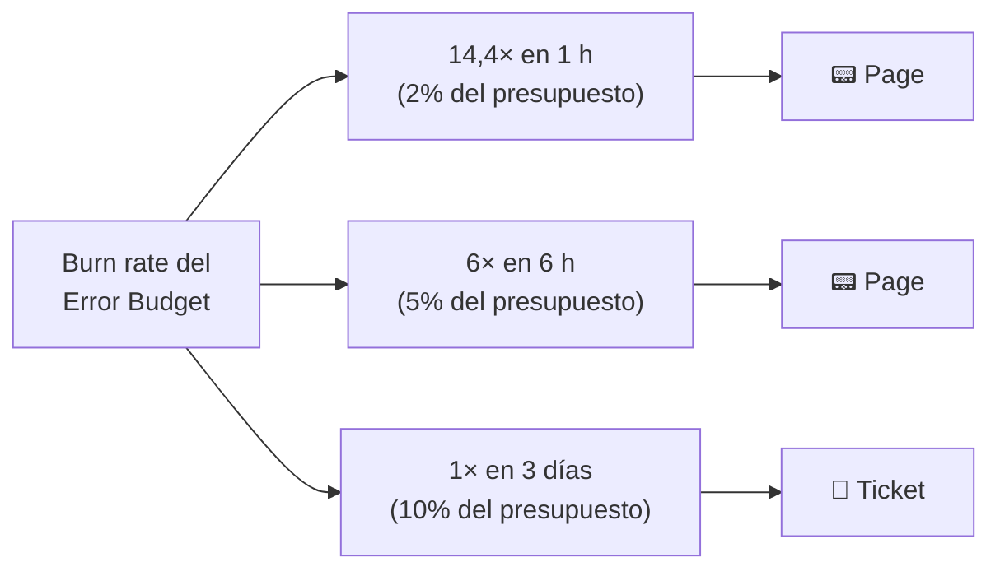

**Guion:**
"El reto uno dice que el CI/CD no detiene ni revierte. Fíjense que son dos verbos distintos y por eso
el Quality Gate tiene tres momentos.
Antes: el pipeline de GitHub Actions —un reusable workflow que mantiene Plataforma, así todas las tribus usan el mismo gate— llega al paso de producción y le pregunta a la
fuente de SLOs —el SLO está escrito como código en Git con Sloth, que genera las reglas de Prometheus— cuánto Error Budget queda y a qué burn rate se está gastando. El burn rate es la
velocidad de consumo: un burn rate de 14,4 se come el presupuesto del mes en unos dos días. Si la Error
Budget Policy dice 'congelado', el paso termina con error y el despliegue no corre. Nadie tiene que
acordarse: es autoejecutable. ¿Y si una tribu borra ese paso? No puede: el paso vive en la plantilla de
Plataforma, una por lenguaje, con los mínimos de calidad, seguridad y confiabilidad. Cada tribu agrega
las pruebas que quiera encima —damos el piso, no el techo—, el paso a producción no depende de su YAML:
lo aprueba una deployment protection rule del environment de producción, una app de Plataforma que
consulta el Error Budget y los mínimos. Y si alguien intenta desplegar sin ese environment, AWS y GCP
no le entregan credenciales por OIDC: el despliegue no arranca. La única excepción es un hotfix de confiabilidad, con aprobación manual y
auditoría.
Durante: si el gate deja pasar, no desplegamos al 100%. No impongo herramientas: si ya usan Argo CD,
Argo Rollouts; si ya tienen un service mesh, Flagger lo automatiza. Cualquiera de las dos manda la versión nueva al 5% del
tráfico y compara, contra Prometheus, la tasa de error y el p99 del canary frente a la versión estable.
Si empeora, revierte solo, antes de que el 95% de los clientes lo note. Esto lo implementé en mi
experiencia anterior y es lo que más baja el Change Failure Rate.
Después: 30 minutos de verificación y un evento de 'cambio desplegado' que queda registrado; en el
eje tres verán por qué ese registro es oro para la IA.
Las alertas siguen el modelo multi-window, multi-burn-rate del SRE Workbook de Google: 14,4 veces en
una hora despierta a alguien, 6 veces en seis horas también, y 1 vez en tres días abre un ticket. Así
no despertamos a nadie por un pico de dos minutos, pero tampoco se nos escapa una fuga lenta."

**Pregunta para hacerle a la mesa:** *"¿Hoy quién es dueño de los pipelines: cada tribu o un equipo
central? ¿Ya existen plantillas corporativas?"*

**Preguntas probables:**
1. *Se acabó el Error Budget, pero negocio exige lanzar una campaña el viernes. ¿Qué haces?* — No es
   un "no" técnico: aplico la Error Budget Policy y escalo con datos. Ofrezco alternativas: feature
   flag a un porcentaje pequeño, ventana de bajo tráfico, canary con rollback automático o aceptación
   formal del riesgo por escrito. Convierto la discusión en una decisión de riesgo explícita.
2. *¿Por qué burn rate y no "alertar si el error pasa del 1%"?* — Un umbral fijo despierta a alguien
   por picos que no ponen en riesgo el SLO y no ve las fugas lentas. El burn rate liga la alerta al
   impacto real sobre el presupuesto; la ventana corta además hace que la alerta se apague rápido
   cuando se arregla.
3. *¿Eso no convierte a Plataforma en un cuello de botella o en policía?* — No: somos habilitadores.
   Solo imponemos el piso mínimo; las tribus extienden la plantilla sin pedirnos permiso y contribuyen
   mejoras por pull request (inner source). Las excepciones existen, con dueño y fecha de vencimiento.

---

## Diapositiva 5 — Eje 2: arquitectura OpenTelemetry multi-cloud (C4 Container) (2,5 min)

**Título:** Un solo camino para toda la telemetría, en AWS, GCP y el datacenter.

**Contenido:**
- OTel Collector **agente** (DaemonSet) por nodo: metadatos de Kubernetes, logs locales, filtrado barato.
- OTel Collector **gateway de dos capas** por nube: capa 1 con `loadbalancing` por traceID, capa 2 con
  `tail_sampling`.
- PII: cada aplicación la enmascara (plantilla de logging); **seguridad extra** de Plataforma con el processor
  `redaction` en el gateway, **dentro de la red del banco**, antes de exportar (SFC, Ley 1581).
- `traceparent` W3C (o B3 en legado) en los headers de IBM MQ hacia el AS400; span links en lo asíncrono.
- OpenTelemetry Operator: auto-instrumentación por anotación, sin cambiar el código de las tribus.

**Diagrama (C4 nivel 2, Container):** dos bloques grandes, "AWS (EKS)" y "GCP (GKE)", iguales por
dentro. En cada uno: pods de microservicios con SDK/auto-instrumentación → **OTel Collector agente**
(DaemonSet, un rombo por nodo) → **Gateway capa 1** (`loadbalancing` por traceID) → **Gateway capa 2**
(`memory_limiter` → `filter` → `redaction` → `tail_sampling` → `batch`, y el connector `spanmetrics`
antes del muestreo). Un tercer bloque, "Datacenter": adaptador IBM MQ instrumentado ↔ AS400, con un
sobre que dice "traceparent en el header". Las salidas de ambos gateways van por OTLP con mTLS a
"Backends de observabilidad" (Mimir para métricas, Tempo para trazas, Loki para logs) y a un pipeline separado "Auditoría regulatoria
(sin muestreo, inmutable)". Una línea roja punteada marca "frontera de la red del banco: ninguna PII
la cruza".

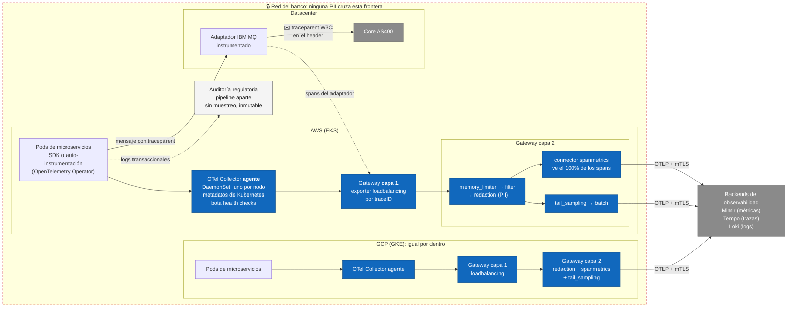

**Guion:**
"Este es el diagrama C4 de nivel Container de la telemetría. La idea es un solo camino estándar, igual
en AWS, en GCP y en el datacenter, con OpenTelemetry, que es neutral frente al proveedor.
En cada nodo de Kubernetes corre un OTel Collector en modo agente, como DaemonSet: recibe la
telemetría local, le pega los metadatos de Kubernetes y bota lo obvio, como los health checks. Las
tribus no tienen que cambiar su código: el OpenTelemetry Operator inyecta la auto-instrumentación con
una anotación en el pod.
Luego viene el OTel Collector en modo gateway, que es donde vive la inteligencia, y tiene dos capas.
¿Por qué dos? Porque para decidir qué traza guardar hay que ver la traza completa, y si los spans de un
mismo pago caen en réplicas distintas, ninguna la ve entera. La capa uno usa el exporter loadbalancing
y enruta por traceID: todos los spans de un pago llegan a la misma réplica. La capa dos hace el
muestreo, que les explico en la siguiente diapositiva.
Dos cosas para DevSecOps. Primera: la PII la enmascara cada aplicación, con la librería de logging de la
plantilla; pero no confiamos en una sola capa, así que Plataforma pone una seguridad extra aquí, con el
processor redaction en el gateway, dentro de la red del banco. La cédula y el número de tarjeta se tachan antes de salir; si lo hiciéramos
en la consola del proveedor, el dato ya habría viajado, y eso incumple la Ley 1581 y las instrucciones
de la Superintendencia Financiera. Segunda: todo viaja por OTLP con mTLS.
Y la frontera con el core: el header traceparent del estándar W3C viaja dentro de los mensajes de IBM
MQ. Si el AS400 no se puede instrumentar, instrumentamos el adaptador MQ de entrada y salida. Así la
traza ya no se corta donde más duele."

**Preguntas probables:**
1. *¿Qué pasa si el gateway se cae en plena crisis?* — Varias réplicas con HPA (Horizontal Pod
   Autoscaler), `sending_queue` con almacenamiento persistente y reintentos, `memory_limiter` para
   degradar en vez de caerse, buffer en los agentes y meta-monitoreo: el Collector expone sus métricas
   de datos aceptados, rechazados y encolados en un stack mínimo independiente.
2. *¿Cómo garantizas que ningún equipo despliegue un Collector sin el redaction?* — Defensa en
   profundidad: el gateway es el único con credenciales de salida, una política OPA bloquea
   configuraciones sin el processor `redaction`, y la imagen se construye con OCB (OpenTelemetry
   Collector Builder) solo con los componentes aprobados y escaneada con Trivy.

---

## Diapositiva 6 — Eje 2: Smart Sampling y FinOps (−30%) (2 min)

**Título:** Pagar por señal, no por ruido: la meta del −30% sin perder un solo error.

**Contenido:**
- Tail-based sampling: 100% de errores, 100% de pagos > 2 s, 5% de los exitosos (`decision_wait` 10 s).
- `spanmetrics` **antes** del muestreo: métricas RED exactas al 100% aunque se descarten trazas.
- Log-to-Metrics (connector `count`) + `filter` de DEBUG en producción.
- Control de cardinalidad: ningún ID único como etiqueta de métrica. Showback de costo por tribu.
- Auditoría regulatoria por un pipeline aparte: nunca se muestrea.

**Diagrama:** de izquierda a derecha, tres pasos: **1. Estudio de línea base** (GB/día por señal y por
servicio, mayores emisores, cardinalidad, factura actual) → **2. Palancas** (tres cajas: trazas → tail sampling;
logs → Log-to-Metrics y filtro de DEBUG; métricas → control de cardinalidad) → **3. Medir antes y después**
contra la meta del −30% y mostrar el costo por tribu (showback). Al pie, una franja de "Referencias públicas":
"Capital One: −70% de volumen de trazas con OpenTelemetry · Pismo (pagos): −80% de costo de observabilidad con
tail sampling".

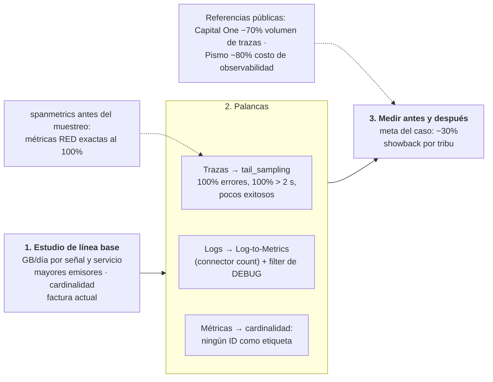

**Guion:**
"El caso pide −30% sin perder trazas de errores. Esa restricción descarta la salida fácil, que sería
guardar menos de todo.
La palanca principal es el tail-based sampling. El head-based sampling decide al inicio de la traza,
con un porcentaje fijo: es barato, pero puede botar justo el pago que iba a fallar. El tail-based
sampling decide al final, cuando ya vio la traza completa: guarda el 100% de los errores, el 100% de los
pagos de más de 2 segundos y solo el 5% de los exitosos y repetitivos.
La pregunta obvia es: si boto el 95% de las trazas exitosas, ¿no quedan mal las métricas? No, porque el
connector spanmetrics calcula las métricas de tasa, errores y duración antes del muestreo. Las métricas
son exactas al 100%; solo muestreamos el detalle.
Segunda palanca, los logs, que suelen ser la mitad de la factura: miles de líneas de 'pago exitoso' se
vuelven un contador con Log-to-Metrics, y los logs de DEBUG no llegan a producción.
Tercera, la cardinalidad: un número de usuario como etiqueta de métrica crea una serie nueva por
cliente. Los IDs van en trazas y logs, nunca en métricas.
¿Cuánto ahorra todo esto en Banco Plus? No les voy a dar una cifra sin conocer sus datos. Lo primero es un
estudio de la línea base: GB por día por señal y por servicio, y la factura actual. Lo que sí sé es que la meta
es alcanzable: Capital One redujo cerca del 70% del volumen de trazas con OpenTelemetry, y Pismo, una
plataforma de pagos, cerca del 80% de su costo de observabilidad con tail sampling. Y a cada tribu le
mostramos su costo, el showback de FinOps, porque lo que no se ve no se
optimiza.
Una aclaración para Operaciones y Riesgo: la telemetría no es el registro de auditoría. La evidencia
regulatoria va por otro pipeline, sin muestreo y con retención legal."

**Preguntas probables:**
1. *¿Y si un regulador pide una transacción cuya traza se descartó?* — La traza nunca fue la evidencia:
   los logs de auditoría y transaccionales van por un pipeline separado, sin muestreo, inmutable y con
   retención legal. El muestreo aplica solo a la observabilidad operativa.
2. *¿Por qué no simplemente bajar la retención a la mitad?* — Porque recorta a ciegas: se pierde
   historia útil para capacidad y post-mortems y no ataca el origen del volumen. Primero se reduce lo
   que entra (muestreo, Log-to-Metrics, cardinalidad); la retención se escalona por niveles (caliente
   corta, fría barata en almacenamiento de objetos) según el uso real.

---

## Diapositiva 7 — Eje 3: telemetría AI-Ready con Semantic Conventions y MCP (2 min)

**Título:** Primero datos que la IA entienda; después, la IA.

**Contenido:**
- Semantic Conventions de OpenTelemetry + resource attributes obligatorios: `service.name`,
  `service.version`, `deployment.environment.name`, equipo dueño, `business.journey=pago_qr`.
- Exemplars y `trace_id` en los logs: de la métrica a la traza y al log en un clic.
- Servidor MCP de observabilidad (solo lectura): `consultar_slo`, `obtener_grafo`, `buscar_trazas`,
  `buscar_logs(trace_id)`, `cambios_recientes`.
- El agente **navega** con herramientas en vez de leer todos los logs: menos costo, menos alucinación.
- Guardarraíles: datos ya sin PII, humano en el bucle, defensa contra Indirect Prompt Injection, auditoría.

**Diagrama:** un embudo de arriba hacia abajo: "Grafo de servicios" → "Métricas / SLOs" → "Trazas" →
"Logs", que es el orden en que el agente consulta. A la izquierda, el "Agente de RCA (cliente MCP)"; en
el medio, el "Servidor MCP de observabilidad" con sus cinco herramientas; a la derecha, los backends y
el registro de cambios del Quality Gate. Debajo, el "Incident Commander" con un candado: "aprueba
cualquier acción".

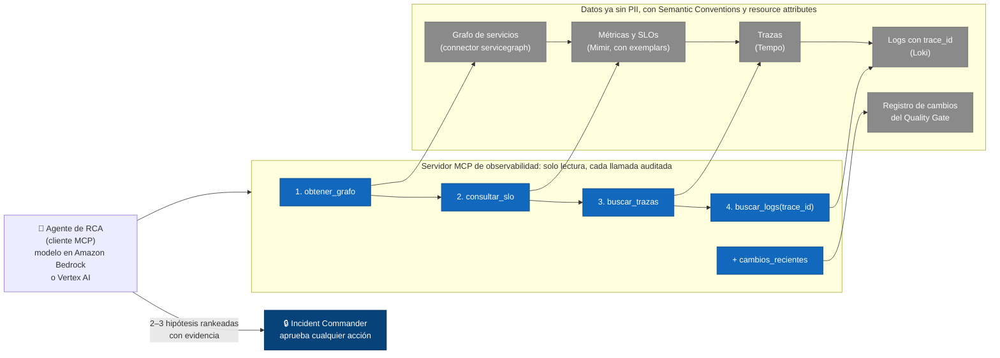

El embudo en el que navega el agente (de lo general a lo específico):

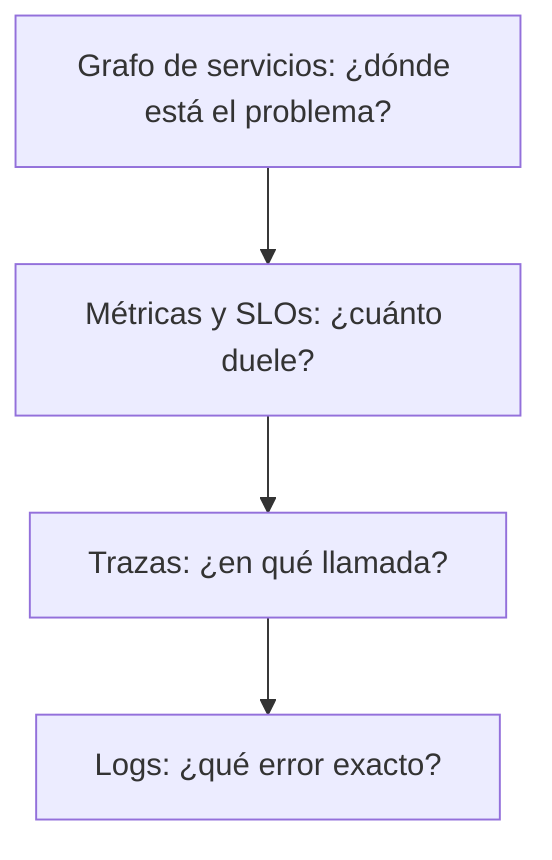

**Guion:**
"El reto cuatro pide preparar la infraestructura para IA causal. La palabra clave es preparar: una IA
no puede razonar sobre datos donde un equipo dice status, otro http_code y otro resp. Primero se ordenan
los datos.
Eso lo resuelven las Semantic Conventions de OpenTelemetry: todo el banco llama igual a lo mismo. Además
definimos resource attributes obligatorios, la cédula de cada servicio: nombre, versión, ambiente,
equipo dueño y el business journey, por ejemplo pago QR. Con eso podemos preguntar algo que hoy es
imposible: cuánto le duele al pago QR, de punta a punta, lo que pasa en un servicio.
Con exemplars, cada pico en una métrica guarda el ID de una traza de ejemplo, y los logs llevan el
mismo trace_id. De la métrica salto a la traza y de la traza al log en un clic.
Encima de esos datos va MCP, Model Context Protocol, el estándar para que un agente de IA use
herramientas. Construimos un servidor MCP de observabilidad de solo lectura con cinco herramientas:
consultar el SLO, obtener el grafo, buscar trazas, buscar logs por trace_id y cambios recientes. Esa
última es la más valiosa, porque la mayoría de los incidentes los causa un cambio, y el Quality Gate
ya los está registrando. En mi experiencia anterior construí un servidor MCP de este tipo, y la
diferencia es enorme: el agente navega como un ingeniero en vez de tragarse todos los logs.
Y los guardarraíles: datos ya sin PII, solo lectura, cada llamada auditada, y el agente trata los logs
como datos, nunca como instrucciones. La IA propone; el humano decide."

**Preguntas probables:**
1. *¿Darle a una IA acceso a la telemetría de producción de un banco no es un riesgo?* — Sí, y se
   controla: servidor MCP de solo lectura con mínimo privilegio, telemetría ya enmascarada en el
   Collector, defensa contra Indirect Prompt Injection (un log puede traer texto de un atacante, por
   ejemplo en la descripción de una transferencia), auditoría de cada llamada, modelo dentro de la cuenta del banco
   (Amazon Bedrock o Vertex AI) y humano en el bucle para cualquier acción.
2. *¿Eso no es lo mismo que prender las alertas inteligentes de la herramienta?* — No. Eso es
   detección de anomalías aislada. Lo que propongo es una capa de contexto estandarizada y neutral:
   cualquier modelo puede usarla, y el razonamiento queda trazable herramienta por herramienta.

---

## Diapositiva 8 — Eje 3, fase 2: grafo de topología e IA causal (2 min)

**Título:** De 200 dashboards a 3 hipótesis: el grafo encuentra dónde nace la falla.

**Contenido:**
- El grafo de dependencias sale gratis de las trazas: connector `servicegraph` (nodos = servicios,
  aristas = llamadas con tasa, errores y p99).
- Regla de causa raíz: el nodo anómalo **más profundo** cuyas dependencias están sanas. El que más
  grita suele ser víctima.
- **DFS** (Depth-First Search) desde el síntoma hacia abajo → causa raíz candidata.
- **BFS** (Breadth-First Search) sobre el grafo invertido → radio de explosión (a quién afecta).
- Cruce con `cambios_recientes` → 2–3 hipótesis rankeadas con evidencia; el humano decide.

**Diagrama:** un grafo de 8 nodos: App QR → API pagos → {Antifraude, Saldos, Notificaciones};
Antifraude → Base de datos de reglas; Saldos → Adaptador MQ → AS400. Nodos en rojo: App QR, API pagos,
Antifraude. Nodos en verde: Base de datos de reglas, Saldos, Notificaciones, Adaptador MQ y AS400. Una
flecha gruesa (DFS) baja de App QR a Antifraude, que queda resaltado: "anómalo y con dependencias sanas
→ candidato". Etiqueta al lado: "v2.3.1 desplegada hace 12 min". Un recuadro (BFS sobre el grafo
invertido) desde Antifraude marca el radio de explosión.

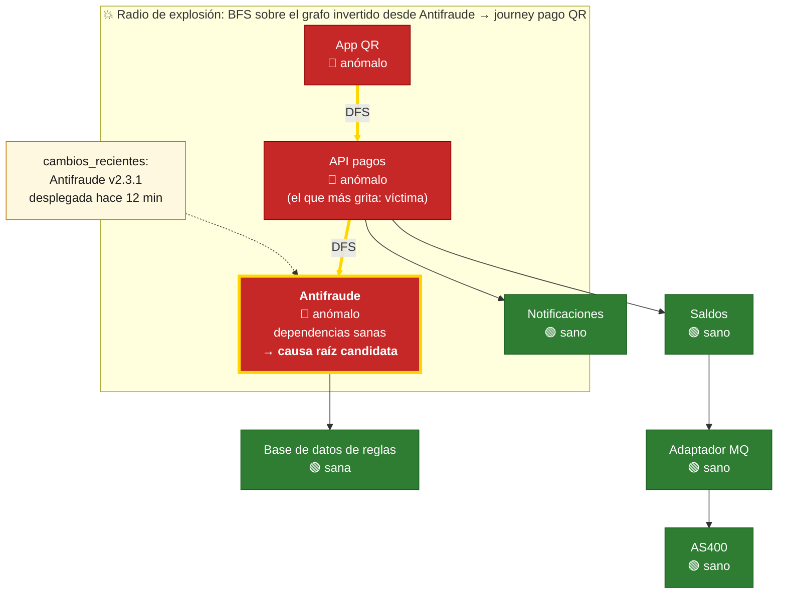

**Guion:**
"Esta es la fase dos del eje tres. No es lo primero que se construye: necesita los datos estandarizados
de la fase uno.
Con trazas estandarizadas, el connector servicegraph nos da gratis un grafo vivo: cada servicio es un
nodo y cada llamada es una arista con su tasa, sus errores y su latencia. Nadie lo dibuja a mano.
Sobre ese grafo aplicamos una regla simple: la causa raíz es el nodo anómalo más profundo cuyas
dependencias están sanas. Es como un trancón: termina donde la calle vuelve a estar libre. En este
ejemplo alertan la app, la API de pagos y antifraude. La API de pagos es la que más grita, pero es
víctima. Recorremos el grafo hacia abajo con DFS, búsqueda en profundidad, y llegamos a antifraude: está
anómalo y sus dependencias están sanas. El servidor MCP cruza ese nodo con cambios recientes: versión
2.3.1, desplegada hace 12 minutos. Esa es la hipótesis número uno, con evidencia.
En paralelo, BFS, búsqueda en anchura, sobre el grafo invertido nos dice el radio de explosión: qué
servicios y qué journeys de negocio están afectados, que es justo lo que necesita el Communications
Lead.
El resultado: en vez de revisar 200 dashboards, el Incident Commander recibe dos o tres hipótesis
rankeadas. Esto es computacionalmente barato, recorrer el grafo es lineal en nodos y aristas, y es la
base de la IA causal y de la auto-remediación futura, siempre con humano en el bucle."

**Preguntas probables:**
1. *Diez servicios alertan a la vez. ¿Cómo sabe la IA cuál es la causa y no un síntoma?* — Correlación
   no es causalidad: todos se correlacionan con la falla. La topología restringe: la causa candidata es
   el nodo anómalo cuyas dependencias están sanas; se confirma con el orden temporal y los cambios
   recientes.
2. *¿Y si hay dos nodos anómalos en ramas distintas?* — Sospecho de una dependencia oculta compartida
   que no está en el grafo: el mismo nodo de Kubernetes, la red, el clúster de Kafka o un certificado.
   Esa brecha se vuelve una acción del post-mortem: instrumentar lo que faltaba.

---

## Diapositiva 9 — Eje 4: el Incident Commander en hora pico (2 min)

**Título:** 12:30 de un día de quincena: el pago QR falla en un 30%.

**Contenido:**
- Roles: Incident Commander (coordina, no toca teclado) · Operations Lead · Communications Lead · Scribe.
- Minuto 0–5: la herramienta de on-call del banco despierta al on-call; declarar SEV1, abrir el canal, asignar
  roles, medir el impacto con el SLO y el burn rate; el incidente queda registrado en el ITSM del banco.
- Minuto 5–15: preguntar **qué cambió** (grafo + `cambios_recientes` vía MCP).
- **Mitigar antes de diagnosticar:** rollback, apagar el feature flag, failover a la otra nube, load
  shedding, circuit breaker.
- Comunicar cada 15–30 min con hechos; confirmar la recuperación con el SLI, no con "parece que ya".

**Diagrama:** una línea de tiempo horizontal de 0 a 60 minutos. Hitos: 0' alerta de burn rate 14,4× →
2' SEV1 declarado → 5' roles asignados → 8' hipótesis del grafo vía MCP → 10' rollback de Antifraude
v2.3.1 (decisión del IC) → 15' primer comunicado → 20' SLI recuperado → 60' monitoreo estable y
programación del post-mortem. Encima, cuatro carriles: IC, Ops Lead, Comms Lead, Scribe.

```mermaid
gantt
    title SEV1 del pago QR, 12:30 de un día de quincena (minuto 0 = 12:30)
    dateFormat HH:mm
    axisFormat %H:%M

    section Incident Commander
    0' alerta de burn rate 14,4× al on-call   :crit, milestone, m0, 12:30, 0m
    2' declara SEV1 y abre el canal              :milestone, m1, 12:32, 0m
    5' asigna roles                              :milestone, m2, 12:35, 0m
    10' decide rollback de Antifraude v2.3.1     :crit, milestone, m3, 12:40, 0m
    60' programa el post-mortem                  :milestone, m4, 13:30, 0m

    section Operations Lead
    Pregunta qué cambió (grafo + MCP)            :ops1, 12:35, 3m
    8' hipótesis lista                           :milestone, m5, 12:38, 0m
    Ejecuta el rollback                          :crit, ops2, 12:40, 10m
    20' SLI recuperado                           :milestone, m6, 12:50, 0m
    Monitoreo hasta que esté estable             :ops3, 12:50, 40m

    section Communications Lead
    15' primer comunicado                        :milestone, m7, 12:45, 0m
    Comunicados cada 15 a 30 min con hechos      :com1, 12:45, 45m

    section Scribe
    Línea de tiempo y registro en el ITSM     :scr1, 12:32, 58m
```

**Guion:**
"Ahora juntemos todo en el peor momento: 12:30 de un día de quincena y el pago QR falla en un 30%.
Primero, la alerta. No llega por CPU: llega porque el burn rate pasó de 14,4 veces en la ventana de una
hora. Ya sabemos que es grave porque está atada al SLO.
La alerta de burn rate llega al on-call por la herramienta de guardia del banco. Como Incident Commander, en los primeros cinco minutos declaro SEV1, abro el canal y asigno roles: un
Operations Lead que ejecuta los cambios técnicos, un Communications Lead que habla con negocio y con los
canales, y un Scribe que lleva la línea de tiempo. La regla de oro del Incident Commander: no toco el
teclado. Si me pongo a depurar, nadie coordina.
Luego hago la pregunta más rentable de cualquier incidente: ¿qué cambió? El grafo y el servidor MCP me
dan en minutos la hipótesis: antifraude, versión 2.3.1, desplegada hace 12 minutos.
Y aquí está la decisión clave: mitigar antes de diagnosticar. No necesito entender el bug para hacer
rollback. Si no hubiera un cambio claro, el menú es: apagar el feature flag, hacer failover a la otra
nube, load shedding para sacrificar las consultas de saldo y salvar los pagos, o un circuit breaker
hacia la dependencia que falla.
El Communications Lead publica cada 15 o 30 minutos, con hechos y sin especular. Y doy por cerrado el
incidente cuando el SLI lo confirma, no cuando 'parece que ya'. Ahí programo el post-mortem.
Todo lo que construimos en los ejes uno, dos y tres sirve aquí: la alerta del SLO, los datos limpios y
las hipótesis. Eso es lo que baja el Time to Restore."

**Preguntas probables:**
1. *¿Y si el rollback no resuelve?* — Pasa al siguiente ítem del menú de mitigación (failover a la otra
   nube, load shedding, circuit breaker) mientras el Ops Lead diagnostica, y se escala a los dueños de
   las dependencias que el radio de explosión señala. El IC fija un tiempo límite por hipótesis para no
   quedarse atascado en una.
2. *¿Quién puede declarar un SEV1?* — Cualquiera, sin pedir permiso. Declarar de más y bajar la
   severidad después es barato; declarar tarde es caro. Las severidades se definen por impacto en el
   cliente y el SLO, no por la causa técnica.

---

## Diapositiva 10 — Eje 4: post-mortem blameless, cultura y hoja de ruta (2 min)

**Título:** Aprender del incidente y cerrar el ciclo: de la crisis a mejores SLOs.

**Contenido:**
- Post-mortem blameless en ≤ 5 días: impacto (clientes, minutos, Error Budget gastado), línea de tiempo,
  factores contribuyentes, acciones con dueño y fecha (prevenir · detectar · mitigar).
- Las acciones vuelven al Eje 1: SLOs, alertas y Quality Gate más finos.
- Team Topologies: Plataforma como habilitador; "you build it, you run it": cada tribu atiende su SLO.
- IDP de autoservicio con Backstage: SLO como código (Sloth), dashboards y alertas por plantilla; toil < 50%,
  Runbook as Code, Game Days.
- Hoja de ruta: 30 días SLO + burn rate · 60 días Quality Gate + gateway con PII · 90 días tail
  sampling medido + MCP de solo lectura.

**Diagrama:** a la izquierda, el ciclo de la diapositiva 1 cerrándose (flecha de "post-mortem" a
"SLO"). A la derecha, una línea de tiempo 30/60/90 días con tres hitos y, debajo, los indicadores de
éxito: Change Failure Rate < 15% · Time to Restore < 1 h · meta de costo de telemetría −30% (medida contra la línea base) · toil < 50%.

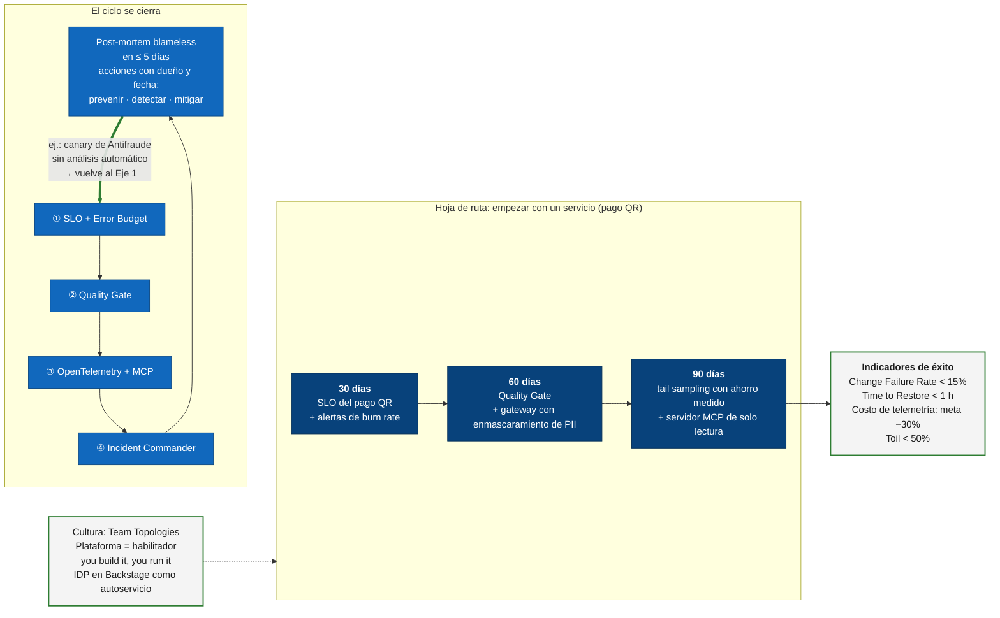

**Guion:**
"El incidente no termina cuando vuelve el servicio: termina cuando aprendimos de él.
En menos de cinco días hacemos el post-mortem blameless, sin culpa. Asumimos que las personas actuaron
razonablemente con la información que tenían, y arreglamos el sistema que permitió el error. Si
castigamos a la persona, la próxima vez nos esconden información, y sin información no hay aprendizaje.
El documento tiene impacto (clientes, minutos y Error Budget gastado), línea de tiempo, factores
contribuyentes en plural, porque los sistemas complejos casi nunca fallan por una sola cosa, y acciones
con dueño y fecha: prevenir, detectar y mitigar. En nuestro ejemplo: el canary de antifraude no tenía
análisis automático, y esa es una acción que vuelve al eje uno. Así se cierra el ciclo.
Y para que esto escale a más de un servicio, la cultura. Mi equipo de plataforma es un habilitador, en
el sentido de Team Topologies, no un policía. Cada tribu opera lo que construye, 'you build it, you run
it', y atiende sus propios SLOs; a nosotros nos alertan solo si falla la plataforma de telemetría. Para
que eso no sea una carga, todo va al IDP (Internal Developer Platform) en Backstage como autoservicio: el SLO como
código, los dashboards y las alertas salen de plantillas. Eliminamos toil: menos del 50% del tiempo en
trabajo manual, runbooks ejecutables y Game Days de caos controlado.
Empezamos pequeño: en 30 días, SLO del pago QR y alertas de burn rate; en 60, Quality Gate y gateway
con enmascaramiento de PII; en 90, tail sampling con el ahorro medido y el primer servidor MCP de solo
lectura. Lo medimos con Change Failure Rate, Time to Restore, costo y toil. Muchas gracias."

**Preguntas probables:**
1. *¿Los 5 porqués no bastan?* — Son útiles pero lineales: llevan a una sola causa y sesgan hacia el
   último humano de la cadena. Los sistemas complejos fallan por varios factores contribuyentes; se
   complementan con preguntas como "¿qué hizo que esta decisión pareciera razonable en el momento?".
2. *Los equipos tradicionales no quieren instrumentar ni operar. ¿Los obligas?* — No: sin mandato.
   Hago pair-programming y talleres para co-crear las plantillas, muestro el valor con el pago QR como
   piloto y uso Error Budgets compartidos para alinear velocidad con estabilidad. Si instrumentar es una
   anotación y el dashboard sale solo, la adopción deja de ser una discusión.
