# Diagramas C4 - Observabilidad y sus herramientas (entrevista Cardif)

Un diagrama C4 (Context, Containers, Components, Code) por idea. Están en Mermaid, así que GitHub los
dibuja directo. Los usa el [libreto](libreto-diapositivas.md) y el generador de la
[presentación](presentacion.html).

Convenciones de color (las del modelo C4):

- **Azul oscuro**: persona.
- **Azul medio**: sistema propio (la plataforma de observabilidad).
- **Azul claro**: contenedor (un paso del flujo, un servicio, un almacén).
- **Gris**: sistema externo (herramienta de terceros).
- **Recuadro punteado**: límite (capa, clúster, ambiente).

Íconos: cada `ico:nombre` es el logo de la herramienta, guardado en [iconos/](iconos/) (logos de
[Iconify](https://icon-sets.iconify.design/)). En GitHub se ven como texto; en la presentación HTML se
ven como logos.

---

## D1 · Contexto: la plataforma de observabilidad y quién la usa

Panorama. Tipo: Contexto.

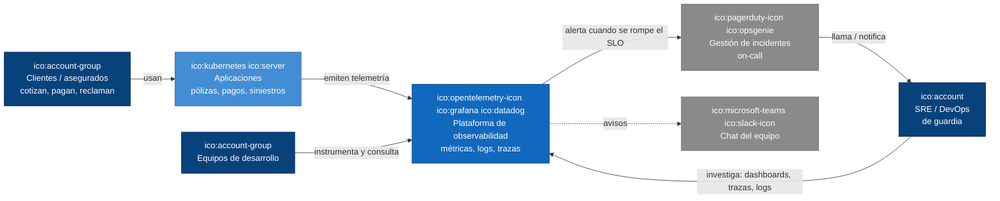

## D2 · Contenedores: las señales de telemetría (MELT)

Panorama. Tipo: Contenedores.

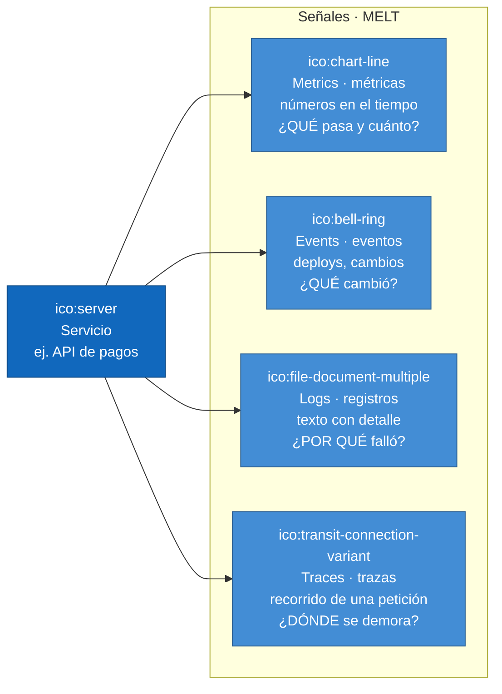

## D3 · Dinámico: los 6 pasos del flujo de telemetría

Panorama. Tipo: Dinámico (pasos numerados).

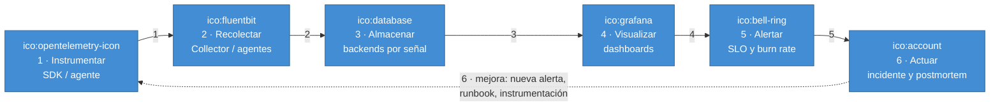

## D4 · Componentes: paso 1, instrumentar con OpenTelemetry

Paso 1. Tipo: Componentes.

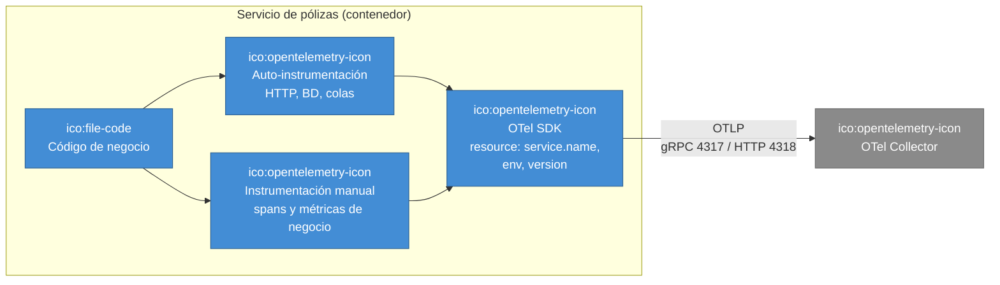

## D5 · Componentes: paso 2, el OpenTelemetry Collector

Paso 2. Tipo: Componentes (pipeline del Collector).

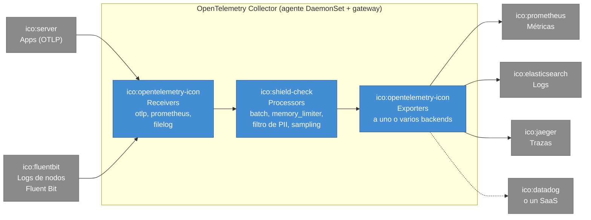

## D6 · Contenedores: paso 3, dónde se guarda cada señal

Paso 3. Tipo: Contenedores.

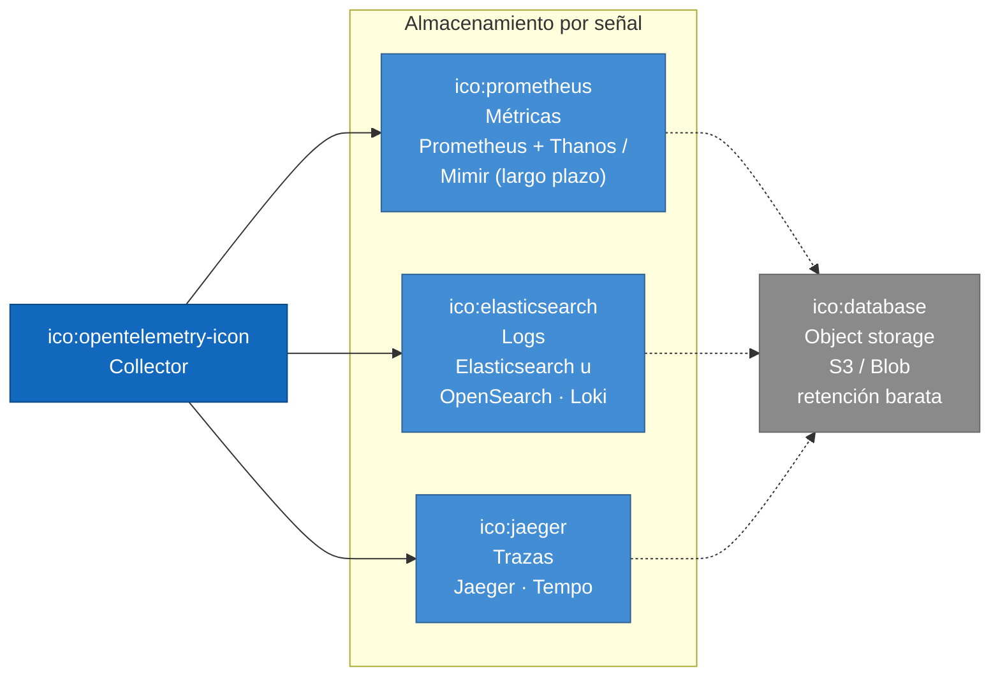

## D7 · Componentes: paso 4, un dashboard útil

Paso 4. Tipo: Componentes (filas de un dashboard).

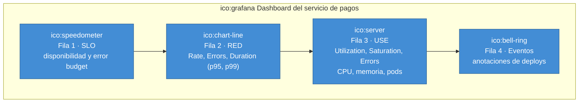

## D8 · Dinámico: paso 5, de SLI a la alerta

Paso 5. Tipo: Dinámico.

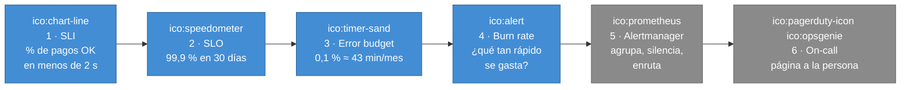

## D9 · Dinámico: paso 6, el ciclo del incidente

Paso 6. Tipo: Dinámico.

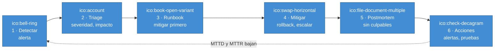

## D10 · Dinámico: correlación con trace_id en 5 microservicios

Correlación. Tipo: Dinámico.

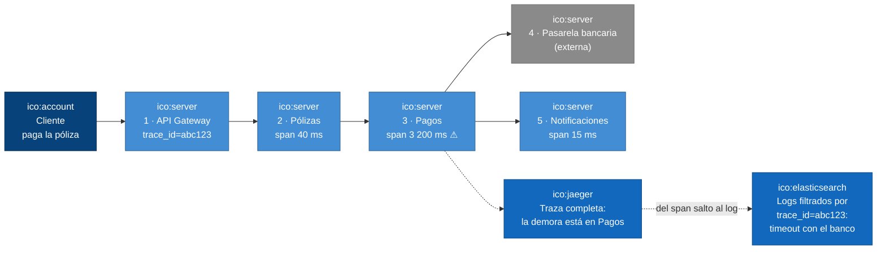

## D11 · Contexto: las tres familias de herramientas

Herramientas. Tipo: Contexto.

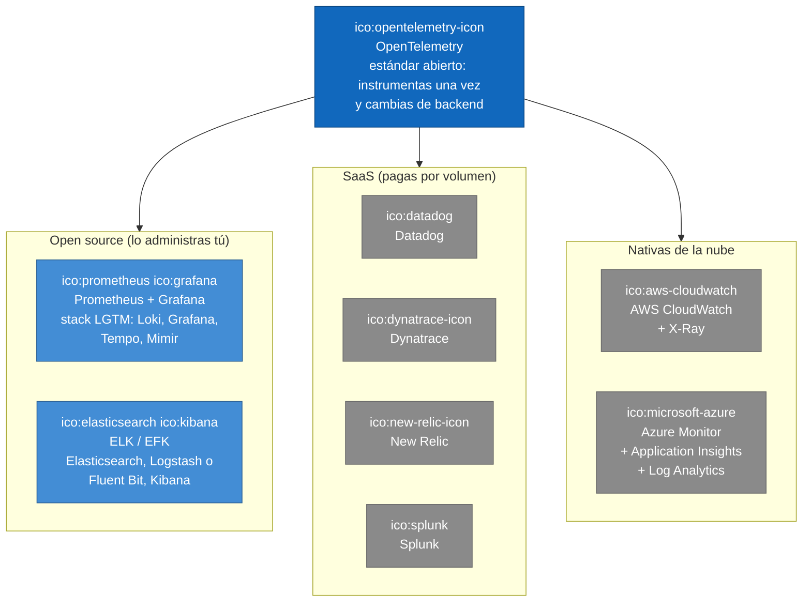

## D12 · Despliegue: observabilidad dentro de Kubernetes

Kubernetes. Tipo: Despliegue.

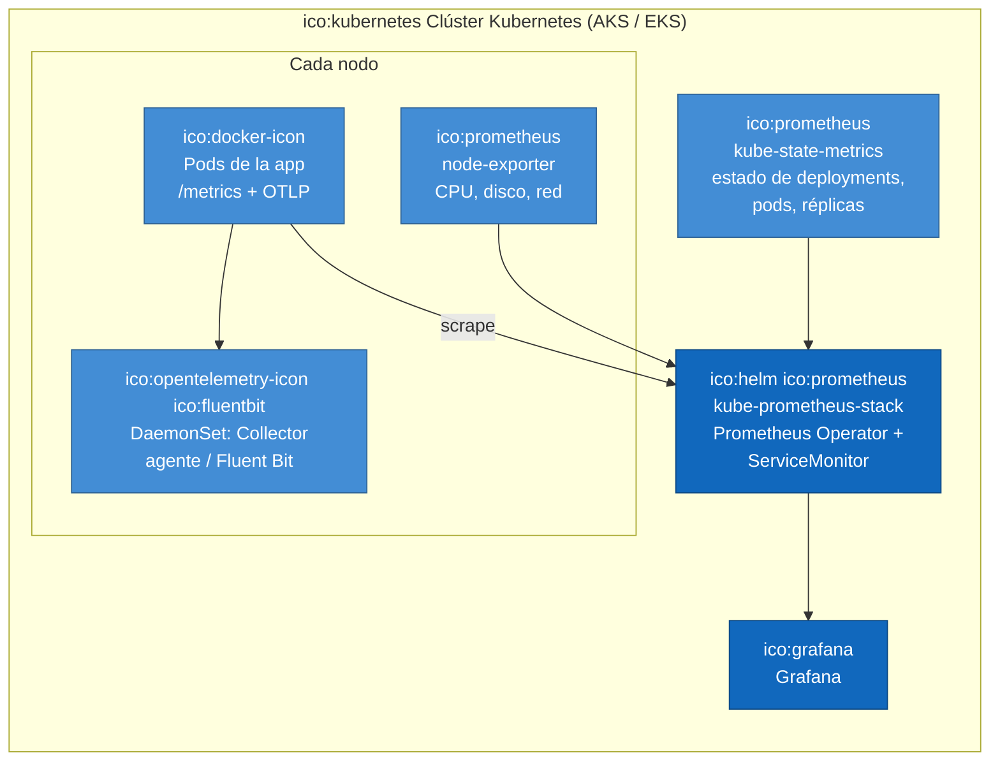

## D13 · Componentes: observabilidad en una aseguradora regulada

Industria. Tipo: Componentes.

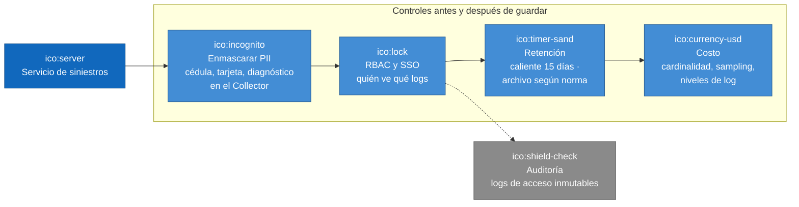

## D14 · Dinámico: IA aplicada a observabilidad (mi caso en MercadoLibre)

Experiencia. Tipo: Dinámico.

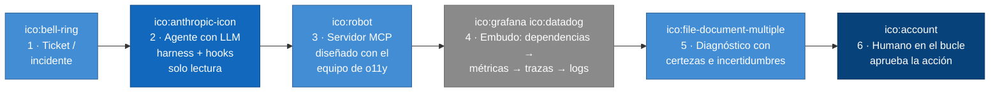
