# Diagramas C4 - Entrevista Chubb (Cloud Engineer Ops, L1)

Un diagrama C4 (Context, Containers, Components, Code) por idea. Están en Mermaid. Los usa el
[libreto](libreto-diapositivas.md) y el generador de la [presentación](presentacion.html).

Convenciones de color (modelo C4). El generador agrega solo los `classDef`, por eso aquí no se repiten:

- **Azul oscuro** (`person`): persona.
- **Azul medio** (`system`): sistema propio.
- **Azul claro** (`container`): contenedor (servicio, pipeline, base de datos).
- **Gris** (`ext`): sistema externo.
- **Recuadro punteado**: límite (empresa, cuenta, red, ambiente).

Íconos: cada `ico:nombre` es un logo de [iconos/](iconos/) (Iconify). En GitHub se ven como texto.

**Parte A** = presentación personal (DA*). **Parte B** = preguntas preparadas (D1… D22).

---

# Parte A · Presentación personal

## DA1 · Contexto: mi recorrido profesional

Tipo: Contexto.

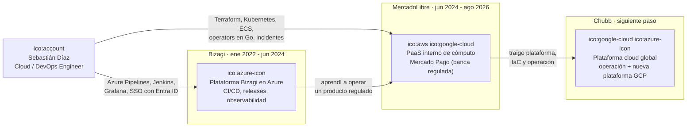

## DA2 · Contenedores: lo que construí en Bizagi

Tipo: Contenedores.

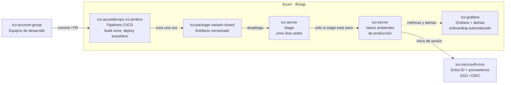

## DA3 · Contenedores: plataforma de cómputo en MercadoLibre

Tipo: Contenedores.

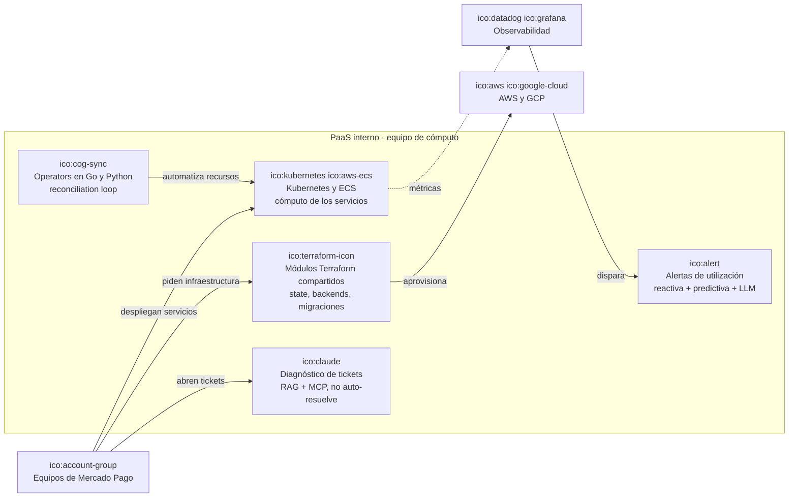

## DA4 · Contexto: por qué encajo en este cargo

Tipo: Contexto (mapa de requisitos de Chubb contra mi experiencia).

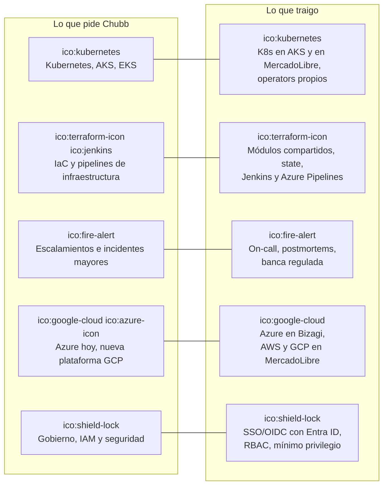

---

# Parte B · Preguntas preparadas

## D1 · Contexto: Azure como lo operé (landing zone)

Pregunta: experiencia en Azure. Tipo: Contexto / Despliegue.

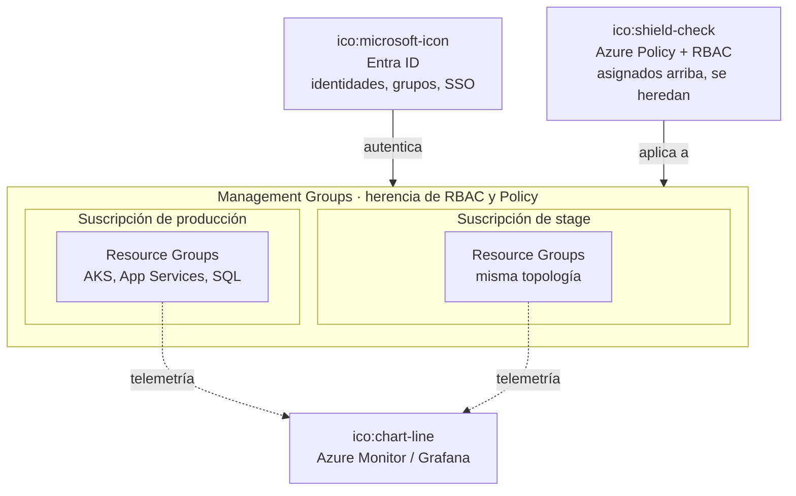

## D2 · Contexto: jerarquía de recursos en GCP

Pregunta: cómo construirías la nueva plataforma GCP (landing zone). Tipo: Contexto.

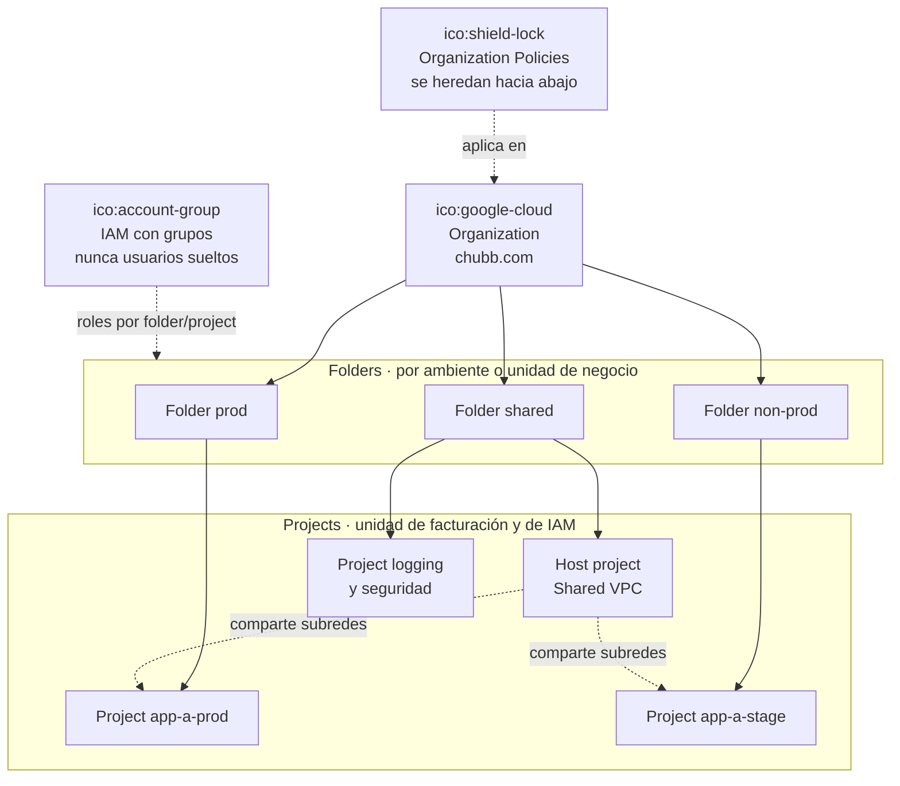

## D3 · Dinámico: plan para la landing zone de GCP

Pregunta: cómo construirías la nueva plataforma GCP. Tipo: Dinámico.

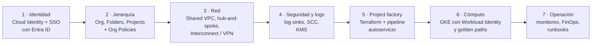

## D4 · Contexto: Cloud Adoption Framework de Microsoft

Pregunta: qué es el Cloud Adoption Framework. Tipo: Contexto (metodologías).

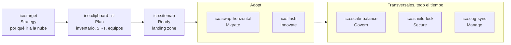

## D5 · Contenedores: estructura de un repositorio de Terraform

Pregunta: cómo organizas Terraform para varios ambientes. Tipo: Contenedores.

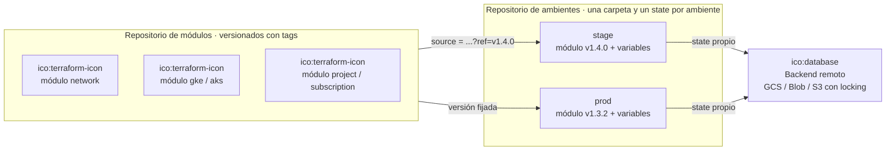

## D6 · Dinámico: pipeline de infraestructura en Jenkins

Pregunta: CI/CD para infraestructura con Terraform y Jenkins. Tipo: Dinámico.

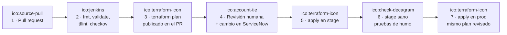

## D7 · Dinámico: drift en Terraform

Pregunta: alguien cambió algo a mano en la consola. Tipo: Dinámico.

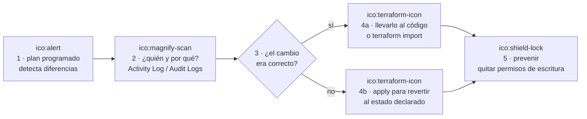

## D8 · Contexto: Terraform vs. Ansible

Pregunta: cuándo usar Terraform y cuándo Ansible. Tipo: Contexto.

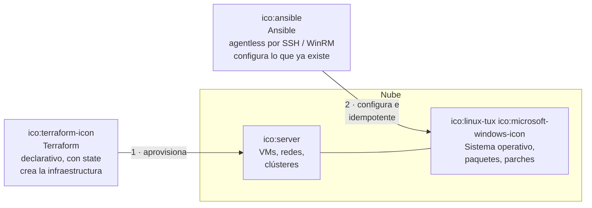

## D9 · Contenedores: arquitectura de Kubernetes

Pregunta: arquitectura de Kubernetes. Tipo: Contenedores.

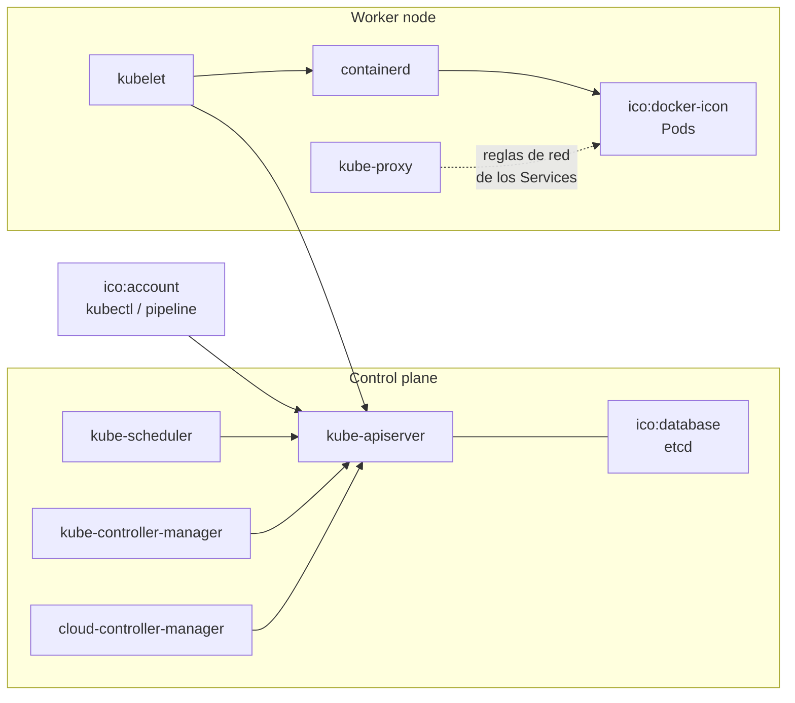

## D10 · Contexto: AKS, EKS y GKE

Pregunta: diferencias entre Kubernetes administrados. Tipo: Contexto.

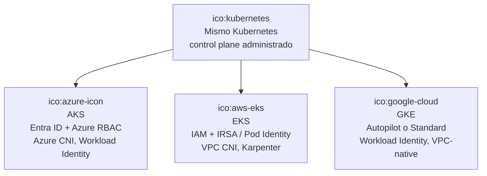

## D11 · Dinámico: un Pod en CrashLoopBackOff

Pregunta: troubleshooting de un Pod que se reinicia. Tipo: Dinámico.

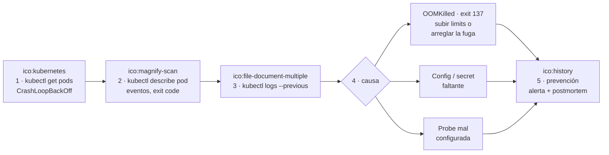

## D12 · Dinámico: incidente mayor en producción

Pregunta: cómo manejas una escalación o un incidente mayor. Tipo: Dinámico.

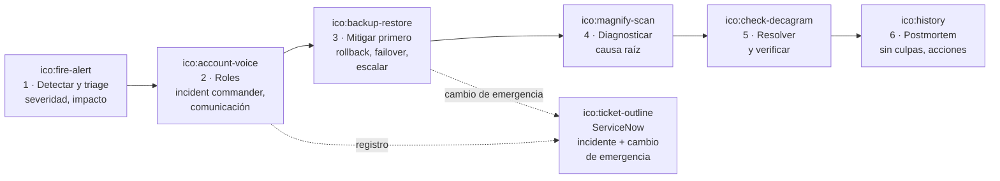

## D13 · Contenedores: monitoreo con Prometheus y ELK

Pregunta: monitoreo y logging. Tipo: Contenedores.

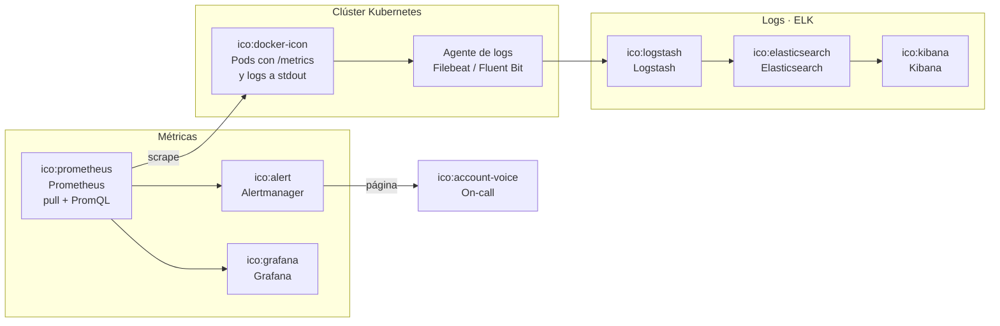

## D14 · Dinámico: gestión de cambios con ServiceNow

Pregunta: change management. Tipo: Dinámico.

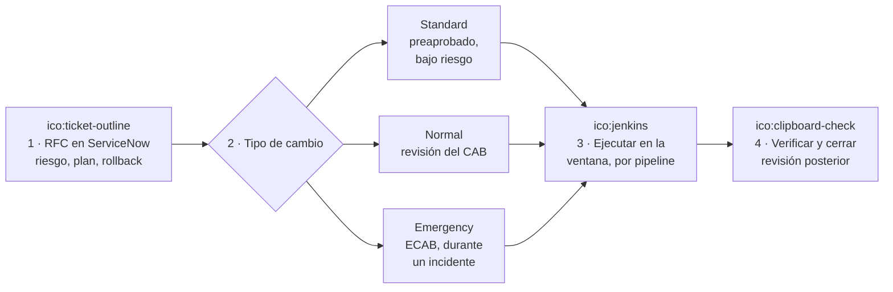

## D15 · Contenedores: gobierno como código

Pregunta: políticas de seguridad y gobierno en Azure (y GCP). Tipo: Contenedores.

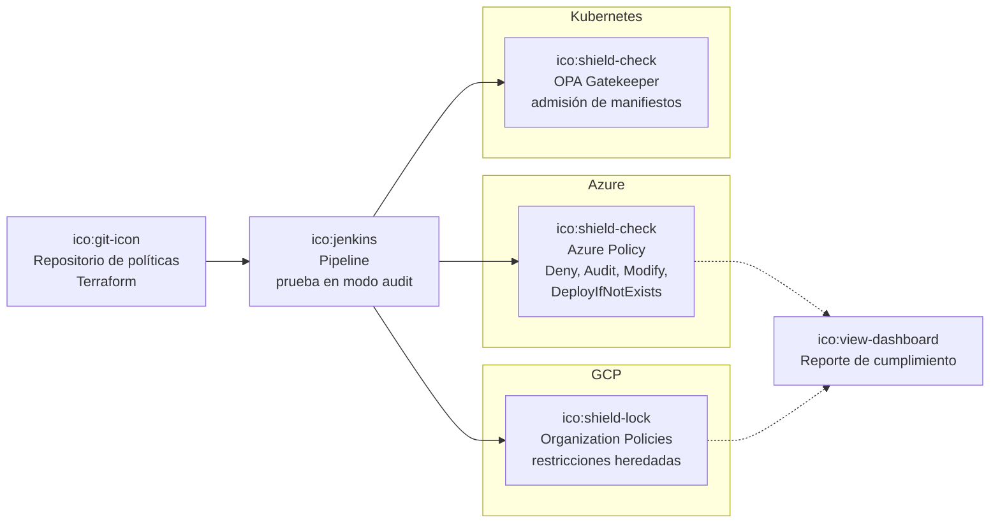

## D16 · Despliegue: red hub-and-spoke

Pregunta: diseño de red en la nube. Tipo: Despliegue.

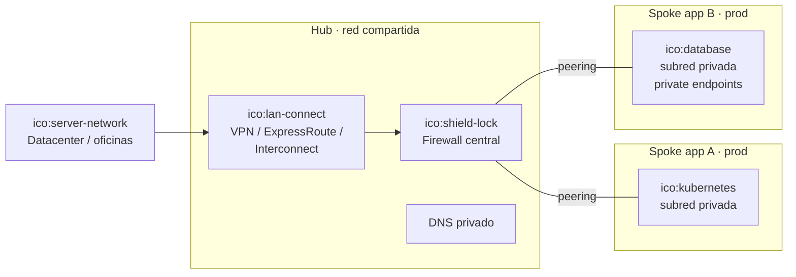

## D17 · Contenedores: IAM sin llaves de larga duración

Pregunta: diseño de IAM y mínimo privilegio. Tipo: Contenedores.

```mermaid
flowchart LR
  hum["ico:account-group<br/>Personas<br/>grupos de Entra ID"]:::person
  sso["ico:microsoft-icon<br/>SSO / OIDC<br/>MFA"]:::ext
  subgraph cloud["Nube"]
    rb["ico:shield-check<br/>Roles por grupo<br/>mínimo privilegio, scope"]:::system
    pim["ico:timer-sand<br/>Acceso privilegiado<br/>just-in-time (PIM)"]:::system
    wi["ico:kubernetes<br/>Workload Identity /<br/>Managed Identity"]:::container
    sec["ico:lock<br/>Key Vault /<br/>Secret Manager"]:::container
  end
  ci["ico:jenkins<br/>Pipeline<br/>federación OIDC"]:::ext
  hum --> sso --> rb
  rb --> pim
  wi -->|"sin llaves en el código"| sec
  ci -->|"token corto, sin secretos"| rb
```

## D18 · Contexto: autoservicio para los equipos de aplicación

Pregunta: cómo construirías autoservicio (self-service). Tipo: Contexto.

```mermaid
flowchart LR
  team["ico:account-group<br/>Equipo de aplicación"]:::person
  subgraph plat["Plataforma cloud · golden path"]
    cat["ico:book-open-variant<br/>Catálogo de servicios<br/>formulario o PR"]:::system
    mods["ico:terraform-icon<br/>Módulos aprobados<br/>seguros por defecto"]:::container
    pipe["ico:jenkins<br/>Pipeline<br/>plan, políticas, apply"]:::container
    docs["ico:school<br/>Documentación<br/>y sesiones"]:::container
  end
  cloud["ico:google-cloud ico:azure-icon<br/>Proyecto o suscripción<br/>listo con red, IAM, logs"]:::ext
  team -->|"pide"| cat --> mods --> pipe --> cloud
  team -.->|"aprende"| docs
```

## D19 · Dinámico: optimización de costos (FinOps)

Pregunta: gestión de costos. Tipo: Dinámico.

```mermaid
flowchart LR
  a["ico:currency-usd<br/>1 · Visibilidad<br/>etiquetas obligatorias<br/>por equipo y app"]:::container
  b["ico:chart-line<br/>2 · Mostrar el costo<br/>showback por equipo"]:::container
  c["ico:content-cut<br/>3 · Optimizar<br/>rightsizing, apagar<br/>no-prod de noche"]:::container
  d["ico:cash<br/>4 · Descuentos<br/>Reservations / CUDs<br/>para lo estable"]:::container
  e["ico:alert<br/>5 · Presupuestos<br/>y alertas"]:::container
  a --> b --> c --> d --> e
  e -.->|"ciclo continuo"| a
```

## D20 · Despliegue: resiliencia y recuperación ante desastres

Pregunta: patrones de resiliencia. Tipo: Despliegue.

```mermaid
flowchart LR
  user["ico:account-group<br/>Usuarios"]:::person
  glb["ico:web<br/>Balanceador global<br/>health checks"]:::ext
  subgraph r1["Región primaria"]
    z1["ico:kubernetes<br/>Zona 1"]:::container
    z2["ico:kubernetes<br/>Zona 2"]:::container
    db1["ico:database<br/>Base de datos<br/>alta disponibilidad"]:::container
  end
  subgraph r2["Región secundaria · DR"]
    z3["ico:kubernetes<br/>Capacidad mínima<br/>o IaC lista"]:::container
    db2["ico:database<br/>Réplica / backups"]:::container
  end
  user --> glb
  glb --> z1
  glb --> z2
  glb -.->|"failover"| z3
  db1 -.->|"replicación<br/>define el RPO"| db2
```

## D21 · Contexto: estrategias de migración (las Rs)

Pregunta: cómo evalúas una aplicación para migrarla a cloud native. Tipo: Contexto.

```mermaid
flowchart LR
  app["ico:server<br/>Aplicación actual"]:::person
  ev["ico:magnify-scan<br/>Evaluación<br/>dependencias, estado,<br/>datos, equipo"]:::system
  r1["Rehost<br/>lift and shift"]:::container
  r2["Replatform<br/>a contenedores o<br/>servicios administrados"]:::container
  r3["Refactor<br/>cloud native"]:::container
  r4["Rebuild / Replace<br/>SaaS"]:::container
  r5["Retire / Retain"]:::container
  app --> ev
  ev --> r1
  ev --> r2
  ev --> r3
  ev --> r4
  ev --> r5
```

## D22 · Dinámico: troubleshooting en Linux y Windows

Pregunta: operación en Linux y Windows. Tipo: Dinámico.

```mermaid
flowchart LR
  s["ico:alert<br/>1 · Síntoma<br/>disco lleno, CPU,<br/>servicio caído"]:::container
  subgraph lx["Linux"]
    l1["ico:linux-tux<br/>df -h, du, lsof +L1<br/>journalctl, ulimit -n"]:::system
  end
  subgraph wn["Windows"]
    w1["ico:microsoft-windows-icon<br/>Event Viewer, PowerShell<br/>Get-Service, perfmon"]:::system
  end
  f["ico:check-decagram<br/>2 · Arreglo<br/>reiniciar con cuidado,<br/>liberar, rotar logs"]:::container
  p["ico:ansible<br/>3 · Prevención<br/>alerta + automatización"]:::container
  s --> l1 --> f
  s --> w1 --> f
  f --> p
```
