# Diagramas C4 - Entrevista técnica Gorilla Logic (Senior Platform DevOps)

Un diagrama C4 (Context, Containers, Components, Code) por idea, sacados de los 5 escenarios del
assessment de Canditech (4 nov 2026) y de la posición "DevOps GCP" que mencionó la reclutadora. Están
en Mermaid, así que GitHub los dibuja directo. Los usa el [libreto](libreto-diapositivas.md) y el
generador de la [presentación](presentacion.html).

Convenciones de color (las del modelo C4):

- **Azul oscuro**: persona.
- **Azul medio**: sistema propio.
- **Azul claro**: contenedor (servicio, paso, almacén).
- **Gris**: sistema externo.
- **Rojo**: lo que falla o el riesgo.
- **Verde**: la corrección o el estado sano.
- **Recuadro punteado**: límite (zona, clúster, repositorio).

Íconos: cada `ico:nombre` es un logo guardado en [iconos/](iconos/) (de
[Iconify](https://icon-sets.iconify.design/)). En GitHub se ven como texto; en la presentación HTML se
ven como logos.

---

## D1 · Contexto: los 5 escenarios del assessment y el método común

Panorama. Tipo: Contexto.

```mermaid
flowchart LR
  yo["ico:account<br/>Yo · Senior Platform<br/>DevOps de guardia"]:::person
  sh["ico:account-tie<br/>Stakeholders<br/>PM, marketing, product"]:::person
  subgraph esc["5 escenarios"]
    e1["ico:cart<br/>1 · E-commerce en AWS<br/>4x tráfico"]:::container
    e2["ico:terraform-icon<br/>2 · Terraform en producción<br/>plan, lock, drift"]:::container
    e3["ico:argo-icon<br/>3 · Incidente EKS<br/>tras sync de Argo CD"]:::container
    e4["ico:swap-horizontal<br/>4 · Canary<br/>progressive delivery"]:::container
    e5["ico:python<br/>5 · platformctl<br/>CLI interna"]:::container
  end
  met["ico:check-decagram<br/>Método<br/>1 estabilizar · 2 diagnosticar<br/>3 corregir en Git · 4 prevenir"]:::ok
  yo -->|"resuelve"| esc
  sh -->|"presiona por atajos"| yo
  esc --> met
  classDef person fill:#08427b,stroke:#052e56,color:#fff
  classDef system fill:#1168bd,stroke:#0b4884,color:#fff
  classDef container fill:#438dd5,stroke:#2e6295,color:#fff
  classDef ext fill:#8a8a8a,stroke:#6b6b6b,color:#fff
  classDef ok fill:#2e7d32,stroke:#1b5e20,color:#fff
```

## D2 · Contenedores: la arquitectura del e-commerce

Bloque 1. Tipo: Contenedores.

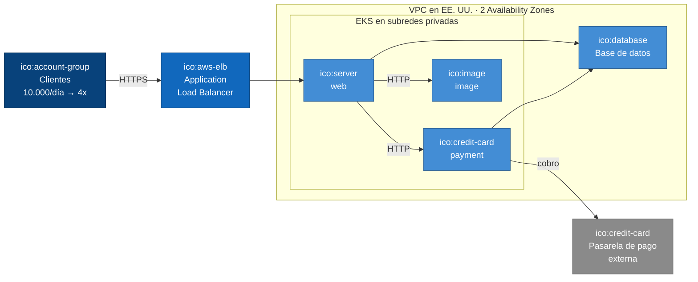

## D3 · Dinámico: sitio lento con 4x tráfico, los 4 pasos

Bloque 1. Tipo: Dinámico (pasos numerados).

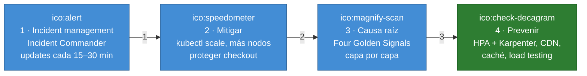

## D4 · Contenedores: usuarios en Asia y la CDN

Bloque 1. Tipo: Contenedores.

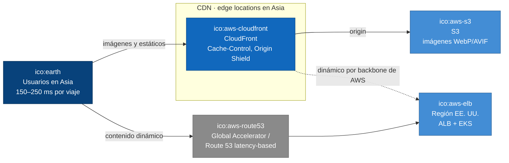

## D5 · Componentes: cortar el efecto dominó

Bloque 1. Tipo: Componentes.

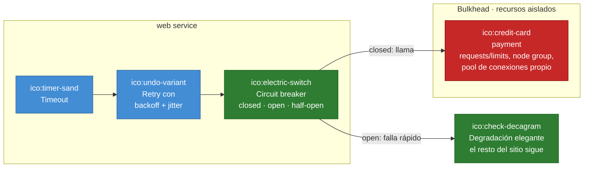

## D6 · Dinámico: la compra asíncrona con cola

Bloque 1. Tipo: Dinámico (pasos numerados).

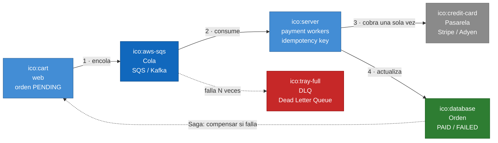

## D7 · Contenedores: Terraform en producción con CI

Bloque 2. Tipo: Contenedores.

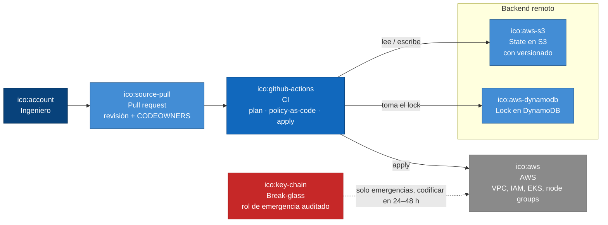

## D8 · Componentes: revisar el plan, split / rework

Bloque 2. Tipo: Componentes.

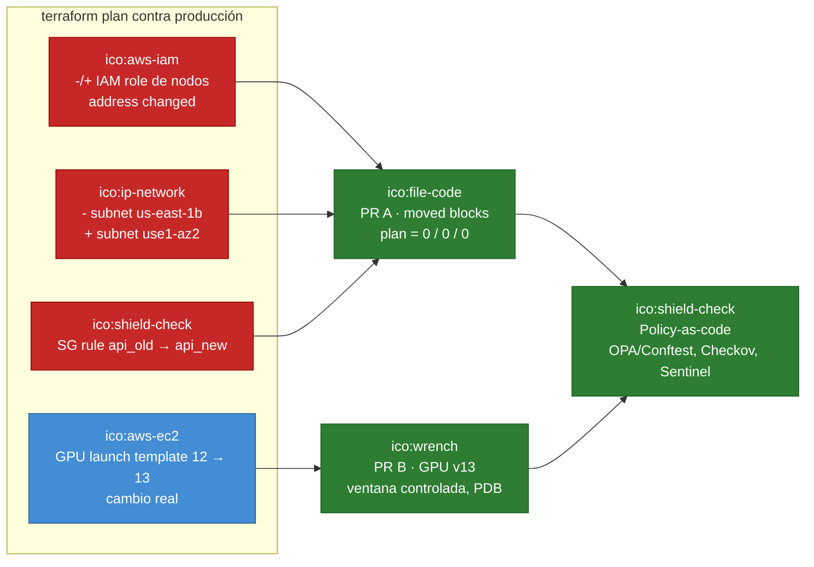

## D9 · Dinámico: state lock huérfano, 7 pasos antes de force-unlock

Bloque 2. Tipo: Dinámico (pasos numerados).

```mermaid
flowchart LR
  s1["ico:lock<br/>1 · Congelar<br/>pausar pipeline, un dueño"]:::container
  s2["ico:server<br/>2 · ¿Proceso vivo?<br/>runner-17, SIGINT"]:::container
  s3["ico:file-lock<br/>3 · Backup<br/>state pull, errored.tfstate"]:::container
  s4["ico:aws-cloudtrail<br/>4 · ¿Qué cambió?<br/>CloudTrail + plan guardado"]:::container
  s5["ico:key-chain<br/>5 · force-unlock<br/>solo si todo se cumple"]:::bad
  s6["ico:scale-balance<br/>6 · Reconciliar<br/>plan -refresh-only, import"]:::container
  s7["ico:check-decagram<br/>7 · Reanudar por CI<br/>postmortem"]:::ok
  s1 -->|"1"| s2 -->|"2"| s3 -->|"3"| s4 -->|"4"| s5 -->|"5"| s6 -->|"6"| s7
  classDef container fill:#438dd5,stroke:#2e6295,color:#fff
  classDef ok fill:#2e7d32,stroke:#1b5e20,color:#fff
  classDef bad fill:#c62828,stroke:#8e0000,color:#fff
```

## D10 · Dinámico: drift por un CIDR agregado a mano

Bloque 2. Tipo: Dinámico (pasos numerados).

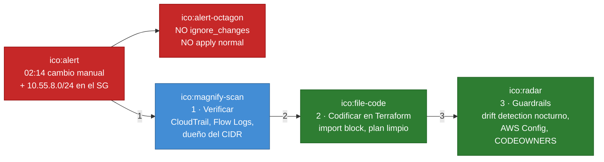

## D11 · Contenedores: el 503 después del sync de Argo CD

Bloque 3. Tipo: Contenedores.

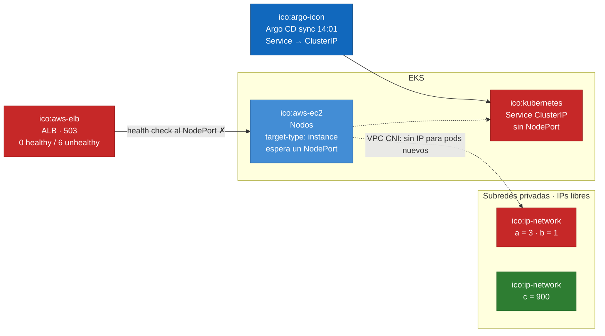

## D12 · Contenedores: el canary que también dañó al stable

Bloque 4. Tipo: Contenedores.

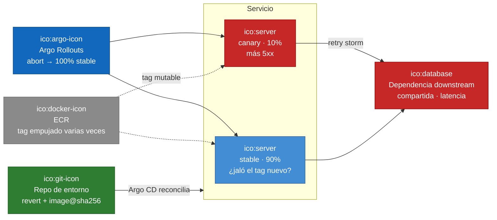

## D13 · Dinámico: expand-contract, para que el rollback siempre sea seguro

Bloque 4. Tipo: Dinámico (pasos numerados).

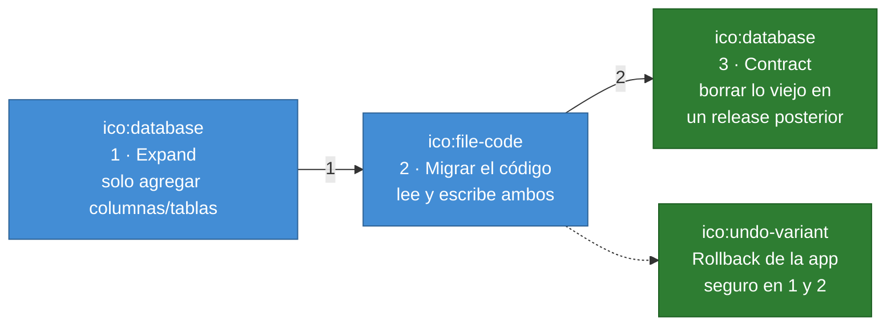

## D14 · Componentes: platformctl v1 y sus 4 riesgos

Bloque 5. Tipo: Componentes.

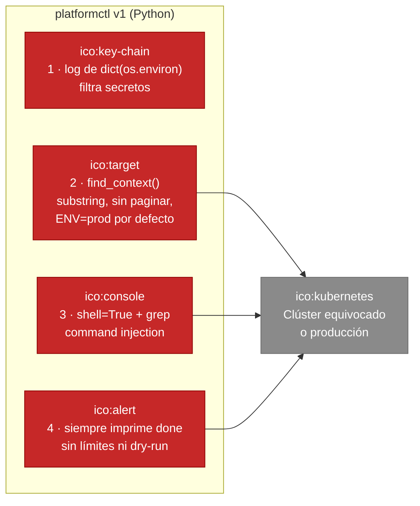

## D15 · Componentes: diseño de platformctl v2

Bloque 5. Tipo: Componentes.

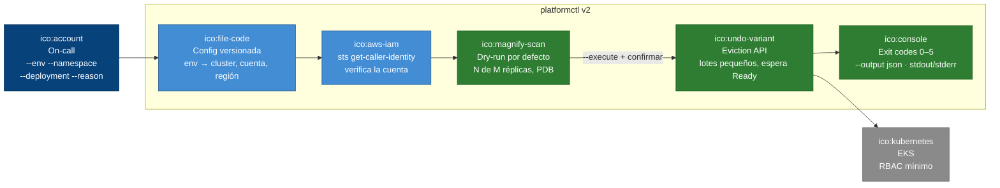

## D16 · Contexto: equivalencias AWS → GCP para la posición "DevOps GCP"

GCP. Tipo: Contexto.

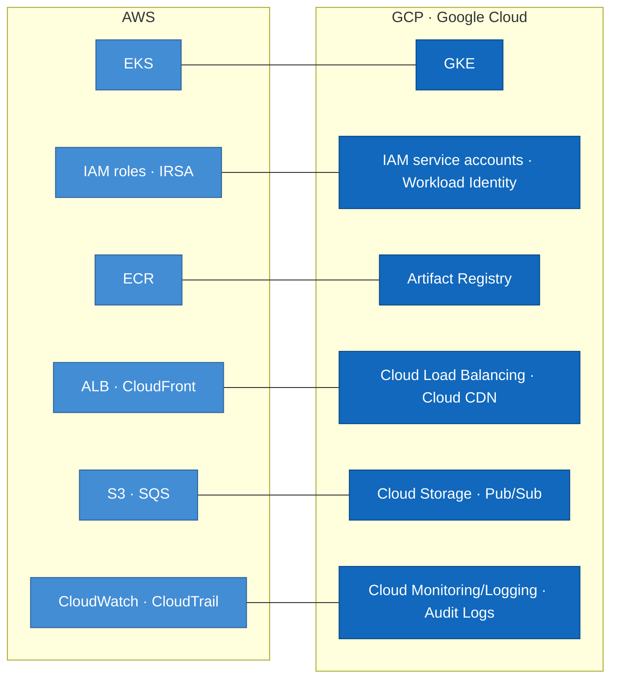
