# Diagramas C4 - CI/CD con aseguramiento de código y cloud security (HITSS para Claro)

Un diagrama C4 (Context, Containers, Components, Code) por idea. Están en Mermaid, así que GitHub los
dibuja directo. Los usa el [libreto](libreto-diapositivas.md) y el generador de la
[presentación](presentacion.html).

Convenciones de color (las del modelo C4):

- **Azul oscuro**: persona.
- **Azul medio**: sistema propio (la plataforma CI/CD).
- **Azul claro**: contenedor (un paso del pipeline, un servicio, un repositorio).
- **Gris**: sistema externo (herramienta de terceros).
- **Recuadro punteado**: límite (fase CI, fase CD, ambiente, capa).

Íconos: cada `ico:nombre` es el logo de la herramienta, guardado en [iconos/](iconos/) (logos de
[Iconify](https://icon-sets.iconify.design/)). En GitHub se ven como texto; en la presentación HTML se
ven como logos.

Tipos de diagrama C4 que aparecen: **Contexto**, **Contenedores**, **Componentes**, **Dinámico** (pasos
numerados en orden) y **Despliegue**.

---

## D1 · Contexto: el sistema de CI/CD y quién lo toca

Panorama. Tipo: Contexto.

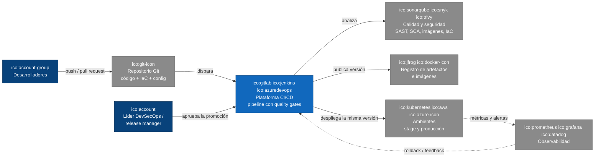

## D2 · Dinámico: el pipeline completo de punta a punta

Panorama. Tipo: Dinámico (pasos numerados).

```mermaid
flowchart LR
  subgraph ci["CI · Continuous Integration"]
    p1["ico:source-pull<br/>1 · Commit y PR"]:::container
    p2["ico:jest<br/>2 · Build y<br/>pruebas unitarias"]:::container
    p3["ico:sonarqube<br/>3 · Calidad<br/>quality gate"]:::container
    p4["ico:snyk<br/>4 · Seguridad del código<br/>SAST, SCA, secretos"]:::container
    p5["ico:docker-icon<br/>5 · Empaquetar, escanear<br/>y firmar"]:::container
  end
  subgraph cd["CD · Continuous Delivery"]
    p6["ico:terraform-icon<br/>6 · Infraestructura<br/>IaC escaneada"]:::container
    p7["ico:argo-icon<br/>7 · Desplegar<br/>en stage"]:::container
    p8["ico:owasp<br/>8 · Pruebas en stage<br/>e2e, DAST, carga"]:::container
    p9["ico:check-decagram<br/>9 · Gate y<br/>aprobación"]:::container
    p10["ico:swap-horizontal<br/>10 · Producción<br/>canary / blue-green"]:::container
    p11["ico:grafana<br/>11 · Observar<br/>y rollback"]:::container
  end
  p1 --> p2 --> p3 --> p4 --> p5 --> p6 --> p7 --> p8 --> p9 --> p10 --> p11
  p11 -.->|"feedback"| p1
  classDef person fill:#08427b,stroke:#052e56,color:#fff
  classDef system fill:#1168bd,stroke:#0b4884,color:#fff
  classDef container fill:#438dd5,stroke:#2e6295,color:#fff
  classDef ext fill:#8a8a8a,stroke:#6b6b6b,color:#fff
```

## D3 · Despliegue: build once, deploy anywhere

Regla de oro. Tipo: Despliegue.

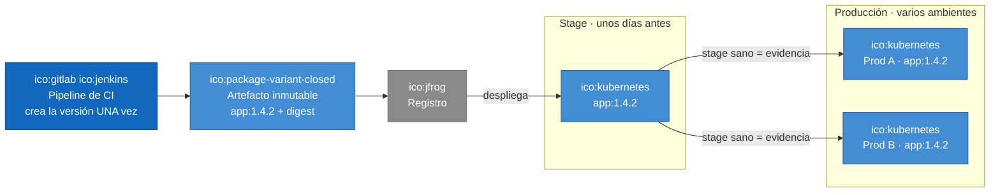

## D4 · Componentes: paso 1, commit y pull request

CI, paso 1. Tipo: Componentes.

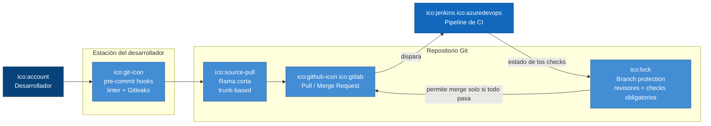

## D5 · Componentes: paso 2, build y pruebas unitarias

CI, paso 2. Tipo: Componentes.

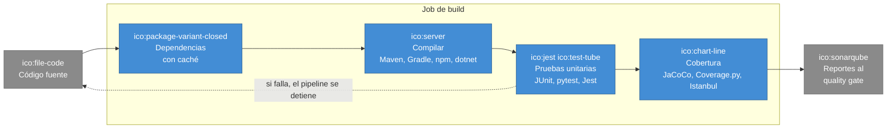

## D6 · Componentes: paso 3, quality gate de calidad

CI, paso 3. Tipo: Componentes.

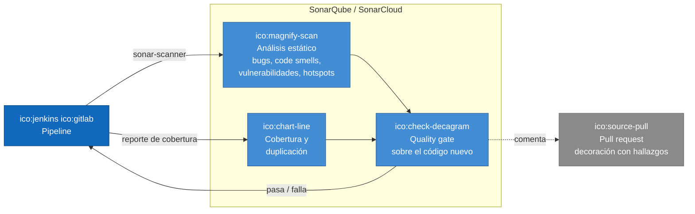

## D7 · Componentes: paso 4, seguridad del código

CI, paso 4. Tipo: Componentes.

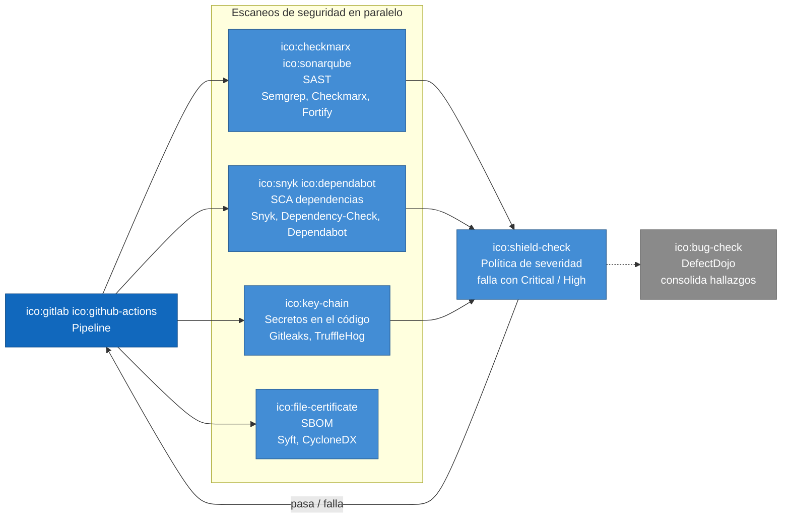

## D8 · Dinámico: paso 5, imagen y cadena de suministro

CI, paso 5. Tipo: Dinámico.

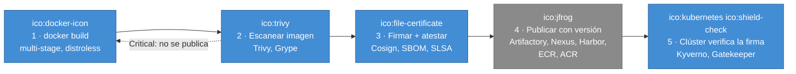

## D9 · Dinámico: paso 6, infraestructura como código segura

CD, paso 6. Tipo: Dinámico.

```mermaid
flowchart LR
  pr["ico:source-pull<br/>1 · PR con cambios<br/>en Terraform"]:::container
  pl["ico:terraform-icon<br/>2 · terraform plan"]:::container
  sc["ico:trivy ico:shield-check<br/>3 · Escaneo IaC<br/>Checkov, tfsec/Trivy, KICS"]:::container
  op["ico:shield-check<br/>4 · Políticas como código<br/>OPA/Conftest, Sentinel"]:::container
  rv["ico:account-group<br/>5 · Revisión humana<br/>del plan"]:::person
  ap["ico:terraform-icon<br/>6 · terraform apply<br/>estado remoto con bloqueo"]:::container
  pr --> pl --> sc --> op --> rv --> ap
  classDef person fill:#08427b,stroke:#052e56,color:#fff
  classDef system fill:#1168bd,stroke:#0b4884,color:#fff
  classDef container fill:#438dd5,stroke:#2e6295,color:#fff
  classDef ext fill:#8a8a8a,stroke:#6b6b6b,color:#fff
```

## D10 · Contenedores: paso 7, despliegue GitOps en stage

CD, paso 7. Tipo: Contenedores.

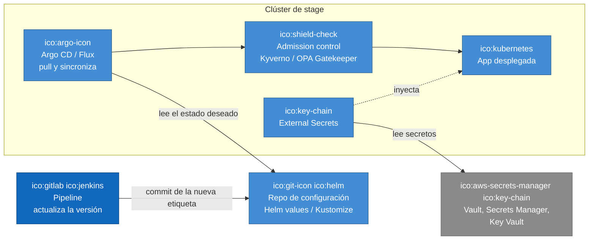

## D11 · Componentes: paso 8, pruebas en stage

CD, paso 8. Tipo: Componentes.

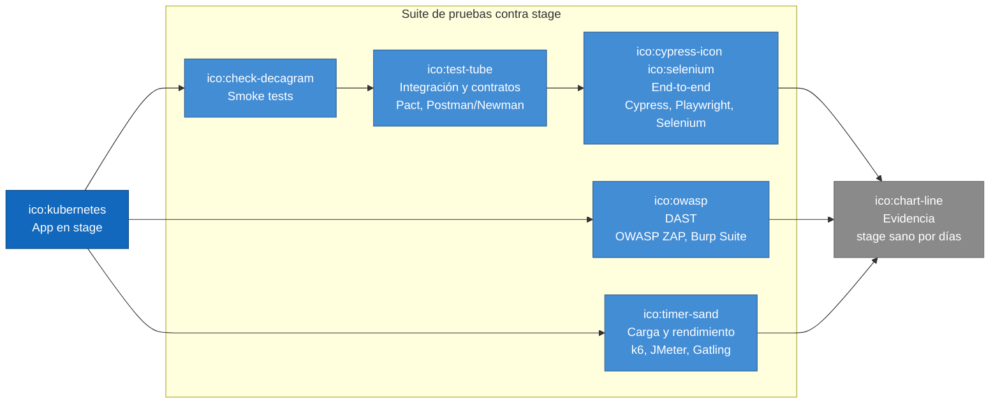

## D12a · Dinámico: paso 9, gate y aprobación

CD, paso 9. Tipo: Dinámico (pasos numerados).

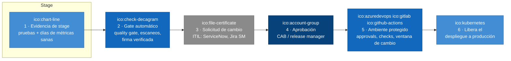

## D12b · Dinámico: paso 10, producción progresiva

CD, paso 10. Tipo: Dinámico (pasos numerados).

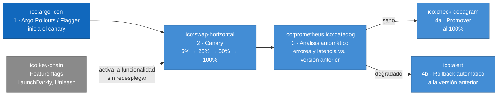

## D13 · Contenedores: paso 11, observar y cerrar el ciclo

CD, paso 11. Tipo: Contenedores.

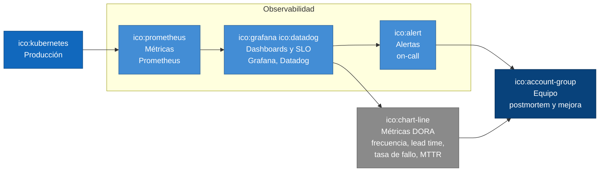

## D14 · Contenedores: cloud security por capas

Cloud security. Tipo: Contenedores.

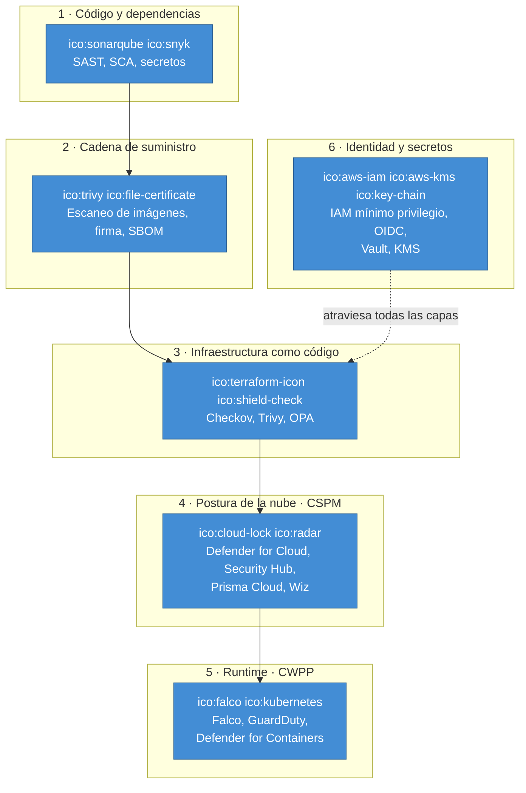

## D15 · Dinámico: el pipeline sin llaves fijas (OIDC)

Cloud security. Tipo: Dinámico.

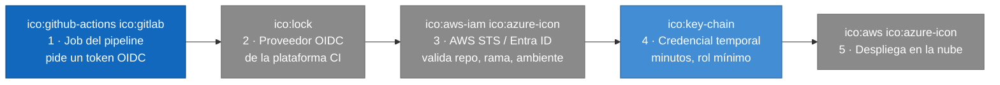

## D16 · Contexto: mi experiencia con CI/CD

Mi experiencia. Tipo: Contexto.

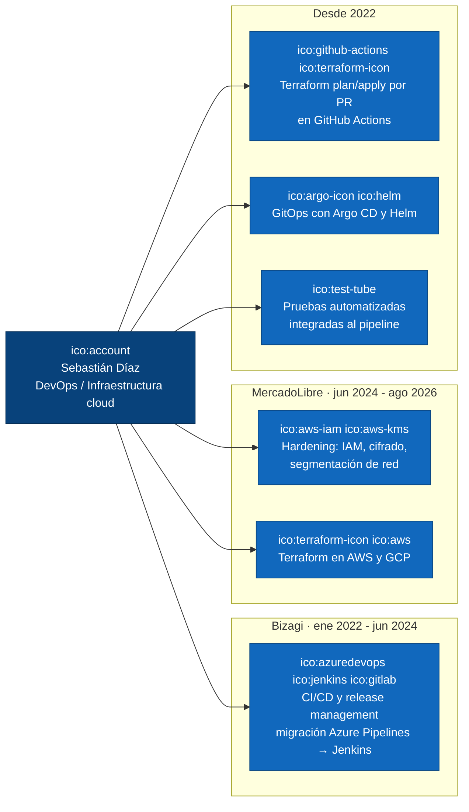
