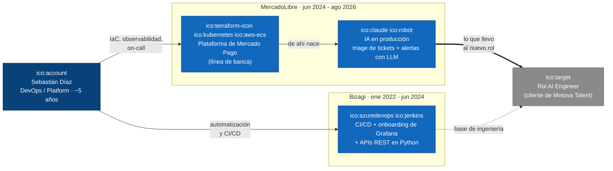
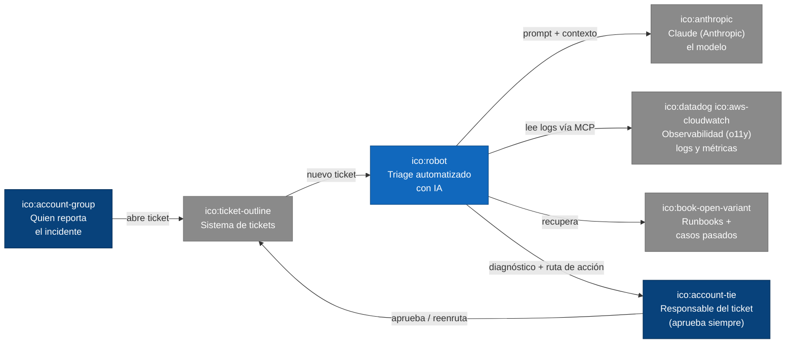
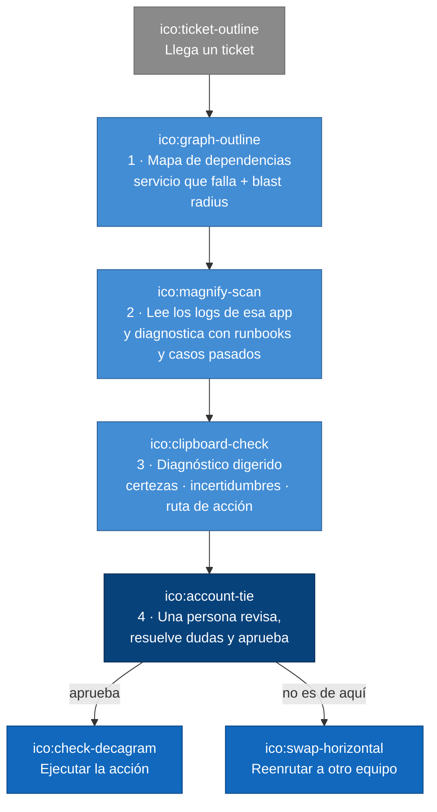
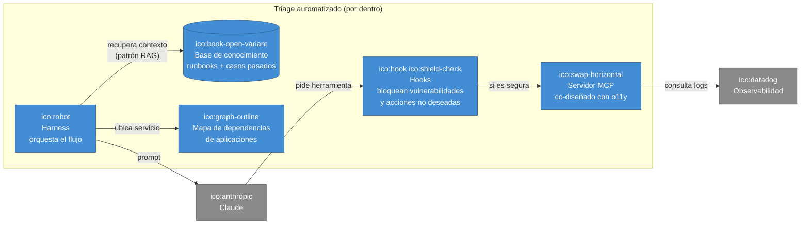
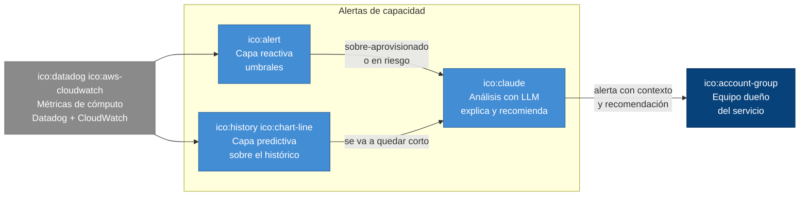
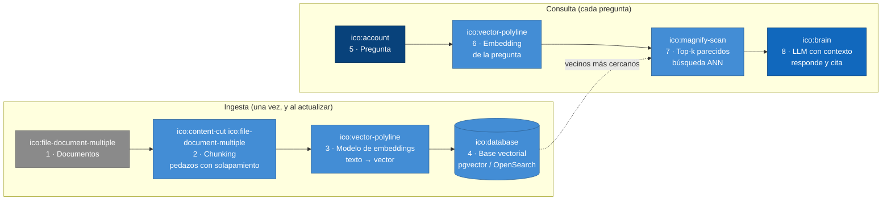
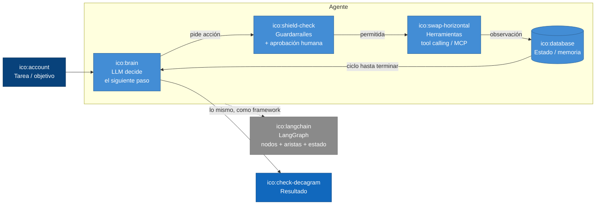
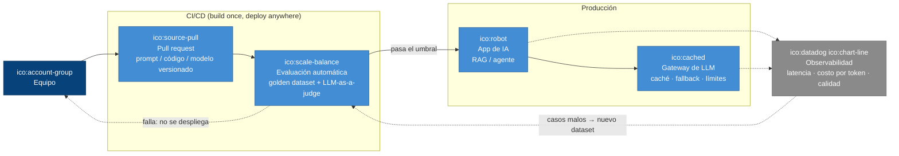
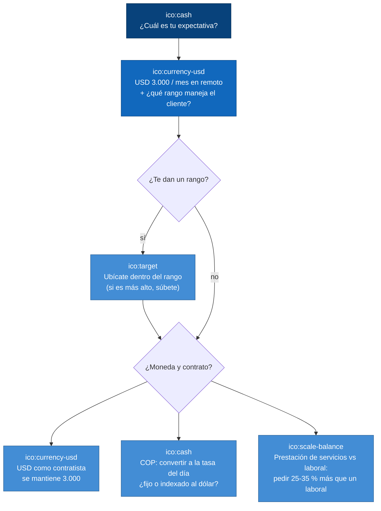
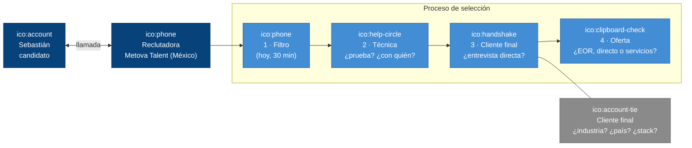

# Diagramas C4 - Llamada de filtro Metova Talent (AI Engineer)

Un diagrama C4 (Context, Containers, Components, Code) por idea de la llamada de filtro
([README.md](README.md)). Están en Mermaid, así que GitHub los dibuja directamente. Los usa el
[libreto](libreto-diapositivas.md) y el generador de la [presentación](presentacion.html).

Convenciones de color (las del modelo C4):

- **Azul oscuro**: persona.
- **Azul medio**: sistema propio.
- **Azul claro**: contenedor (servicio, base de datos, pipeline).
- **Gris**: sistema externo.
- **Recuadro punteado**: límite (empresa, sistema, etapa).

Íconos: cada `ico:nombre` es un logo guardado en [iconos/](iconos/) (sacados de
[Iconify](https://icon-sets.iconify.design/): sets `logos`, `mdi`, `devicon` y `simple-icons`).

Regla de honestidad para todos los diagramas: solo aparece lo que Sebastián hizo y puede defender.
LangChain y LangGraph aparecen **solo como el equivalente** de lo que él construyó, nunca como
herramientas que haya usado.

---

## D1 · Contexto: el puente DevOps → AI Engineer

Pitch "cuéntame de ti". Tipo: Contexto.

## D2 · Contexto: triage automatizado de tickets con IA

Experiencia con LLM. Tipo: Contexto.

## D3 · Dinámico: los 4 pasos del triage (human-in-the-loop)

Experiencia con LLM. Tipo: Dinámico.

## D4 · Componentes: harness, hooks, MCP y base de conocimiento

Experiencia con LLM y agentes. Tipo: Componentes.

## D5 · Contenedores: alertas de capacidad con capa predictiva y LLM

Experiencia con LLM (segundo ejemplo). Tipo: Contenedores.

## D6 · Dinámico: RAG (Retrieval-Augmented Generation) de punta a punta

Repaso técnico: RAG, embeddings y bases vectoriales. Tipo: Dinámico.

## D7 · Componentes: anatomía de un agente (y su equivalente en LangGraph)

Repaso técnico: agentes, LangChain y LangGraph. Tipo: Componentes.

## D8 · Contenedores: LLMOps, donde pesa el perfil DevOps

Repaso técnico: evaluación de LLM y MLOps/LLMOps. Tipo: Contenedores.

## D9 · Dinámico: cómo responder la pregunta del salario

Salario y modelo de contratación. Tipo: Dinámico.

## D10 · Contexto: quién es quién en el proceso

Preguntas para la reclutadora. Tipo: Contexto.

