# Diagramas C4 - Entrevista técnica Metova Talent (AI Engineer)

Diagramas C4 (Context, Containers, Components, Code) para la entrevista técnica del 6 nov 2026. Están
en Mermaid. Los usa el [libreto](libreto-diapositivas.md) y el generador de la
[presentación](presentacion.html). Los íconos están en [../iconos/](../iconos/).

Colores C4: **azul oscuro** = persona, **azul medio** = sistema propio, **azul claro** = contenedor,
**gris** = sistema externo, **punteado** = límite.

Regla de honestidad: LangChain, LangGraph, LlamaIndex, AutoGen, CrewAI y A2A (Agent-to-Agent)
aparecen como **conceptos que conoces y su equivalente en lo que construiste**, no como herramientas
que hayas usado en producción. Lo que sí hiciste: LLM (Claude) en producción con harness, hooks,
servidores MCP (Model Context Protocol), base de conocimiento (patrón RAG) y aprobación humana.

---

## T1 · Contexto: las 5 habilidades contra tu experiencia real

Tipo: Contexto.

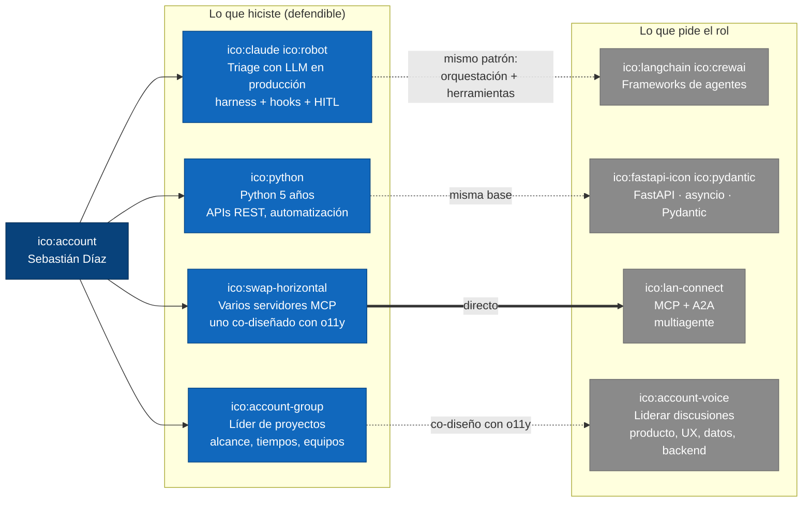

## T2 · Componentes: arquitectura de MCP (Model Context Protocol)

Tipo: Componentes.

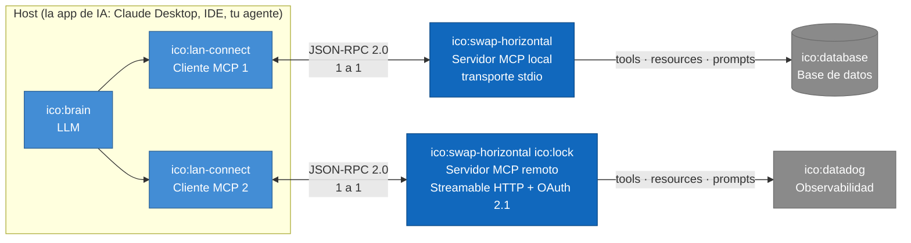

## T3 · Dinámico: una tarea con A2A (Agent-to-Agent)

Tipo: Dinámico.

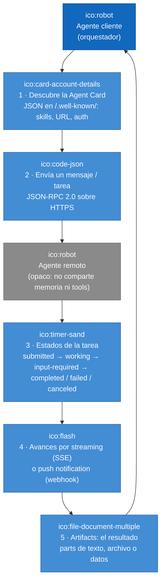

## T4 · Contenedores: arquitectura multiagente de referencia para un negocio

Tipo: Contenedores.

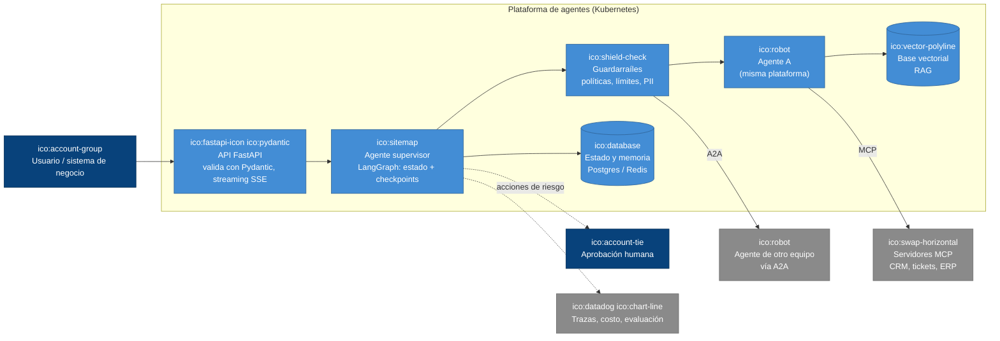

## T5 · Componentes: los 4 frameworks y su idea central

Tipo: Componentes.

```mermaid
flowchart TB
  subgraph lc["LangChain + LangGraph"]
    lc1["ico:langchain<br/>LangChain: modelos, prompts,<br/>tools, retrievers (LCEL)"]:::container
    lc2["ico:sitemap<br/>LangGraph: StateGraph<br/>nodos, aristas, checkpointer, interrupt"]:::container
  end
  subgraph li["LlamaIndex"]
    li1["ico:file-document-multiple<br/>Documents → Nodes → Index<br/>retriever, query engine"]:::container
    li2["ico:flash<br/>Workflows y agentes<br/>por eventos"]:::container
  end
  subgraph ag["AutoGen (Microsoft)"]
    ag1["ico:microsoft-icon<br/>Agentes que conversan<br/>AssistantAgent, group chat"]:::container
  end
  subgraph cr["CrewAI"]
    cr1["ico:crewai<br/>Agent: role · goal · backstory<br/>Task · Crew · Process"]:::container
  end
  lc1 --> lc2
  li1 --> li2
  classDef person fill:#08427b,stroke:#052e56,color:#fff
  classDef system fill:#1168bd,stroke:#0b4884,color:#fff
  classDef container fill:#438dd5,stroke:#2e6295,color:#fff
  classDef ext fill:#8a8a8a,stroke:#6b6b6b,color:#fff
```

## T6 · Dinámico: tu triage traducido a un grafo de LangGraph

Tipo: Dinámico.

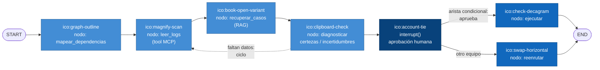

## T7 · Dinámico: una petición asíncrona en FastAPI

Tipo: Dinámico.

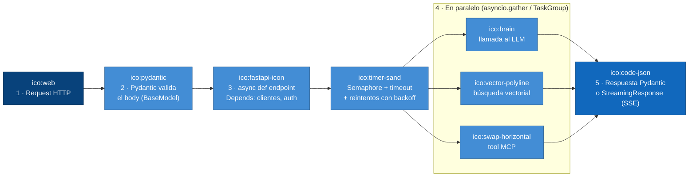

## T8 · Contexto: cómo lideras la discusión técnica entre equipos

Tipo: Contexto.

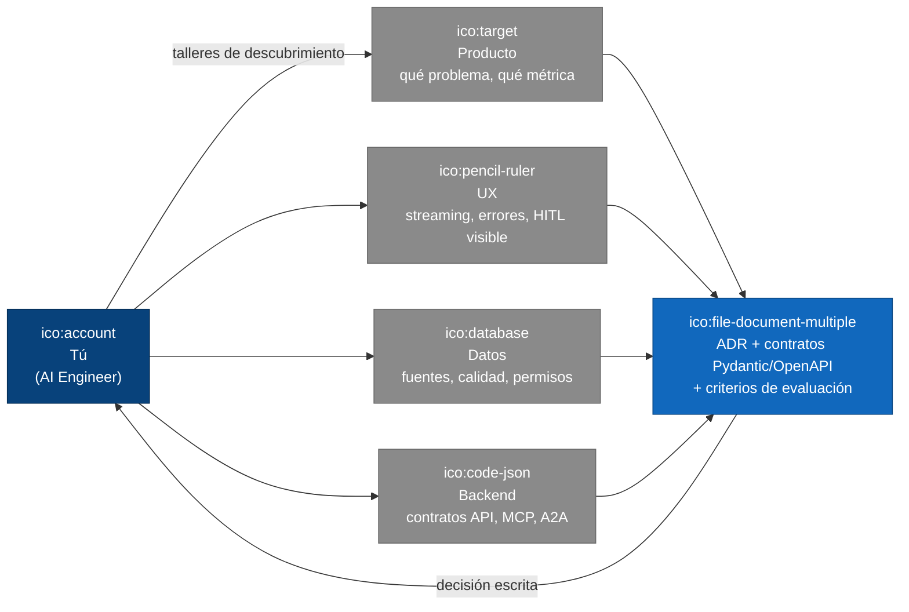

## T9 · Componentes: LangChain, las piezas y cómo se encadenan (LCEL)

Tipo: Componentes.

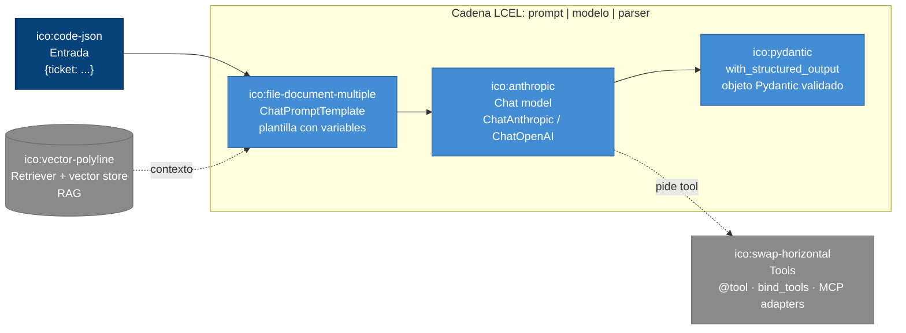

## T10 · Dinámico: LlamaIndex, de documentos a respuestas

Tipo: Dinámico.

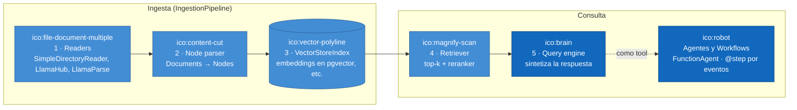

## T11 · Componentes: CrewAI, un equipo de agentes por roles

Tipo: Componentes.

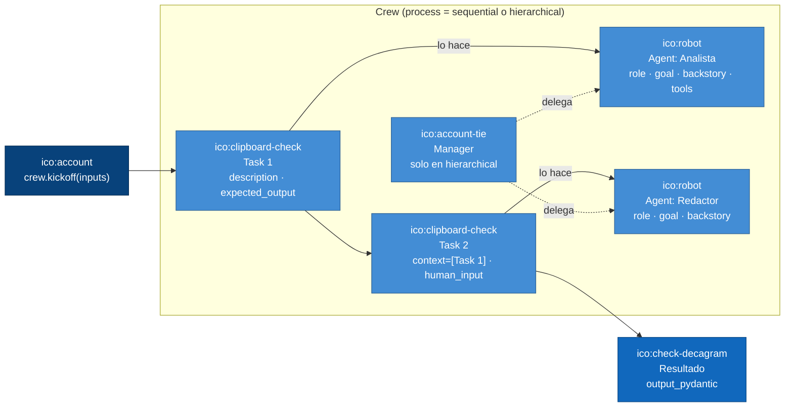

## T12 · Dinámico: AutoGen, agentes que conversan en equipo

Tipo: Dinámico.

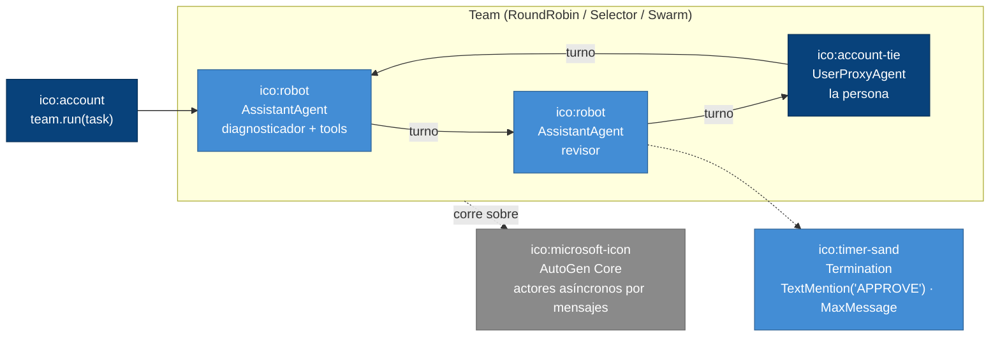
