# Diagramas C4 - Entrevista Niuro (AWS Infrastructure Engineer)

Un diagrama C4 (Context, Containers, Components, Code) por idea, uno o más por pregunta de la
entrevista ([README.md](README.md)). Están en Mermaid, así que GitHub los dibuja directo. Los usa el
[libreto](libreto-diapositivas.md) y el generador de la [presentación](presentacion.html).

Convenciones de color (las del modelo C4):

- **Azul oscuro**: persona.
- **Azul medio**: sistema propio.
- **Azul claro**: contenedor (servicio, base de datos, pipeline).
- **Gris**: sistema externo.
- **Recuadro punteado**: límite (cuenta, VPC, zona, ambiente).

Íconos: cada `ico:nombre` es el logo de la herramienta, guardado en [iconos/](iconos/) (logos de
[Iconify](https://icon-sets.iconify.design/): sets `logos`, `mdi`, `devicon` y `simple-icons`). En GitHub
se ven como texto; en la presentación HTML se ven como logos.

Tipos de diagrama C4 que aparecen: **Contexto** (el sistema y quién lo usa), **Contenedores** (las
piezas que se despliegan), **Componentes** (el interior de una pieza), **Dinámico** (pasos numerados en
orden) y **Despliegue** (dónde corre cada cosa en la infraestructura).

---

## D1 · Contexto: mi rol en dos plataformas

Pregunta 1. Tipo: Contexto.

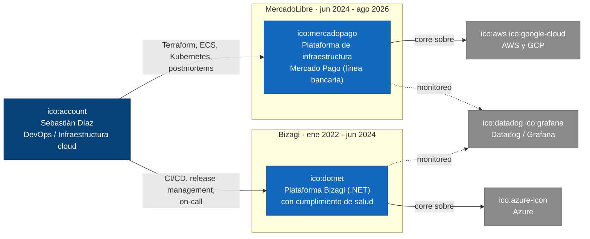

## D2a · Contexto: cargas financieras sensibles en AWS

Pregunta 2. Tipo: Contexto.

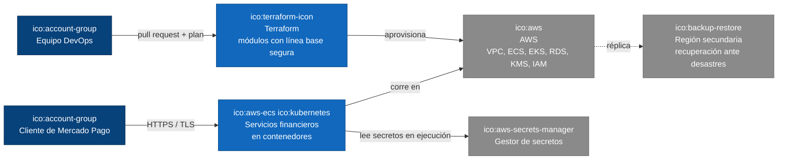

## D2b · Contenedores: aislamiento y menor privilegio

Pregunta 2. Tipo: Contenedores.

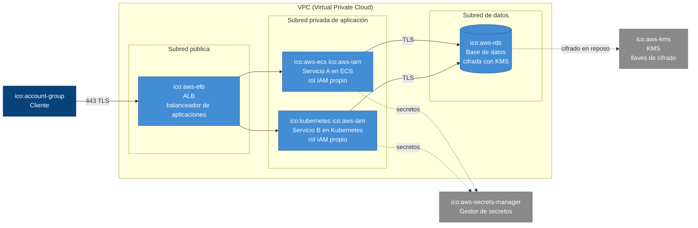

## D3a · Contenedores: blue/green con base de datos compartida

Pregunta 3. Tipo: Contenedores.

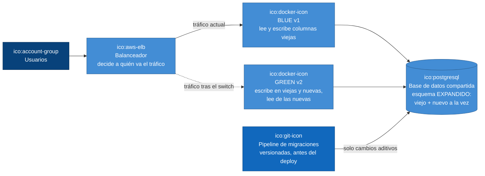

## D3b · Dinámico: las cinco fases de expand/contract

Pregunta 3. Tipo: Dinámico.

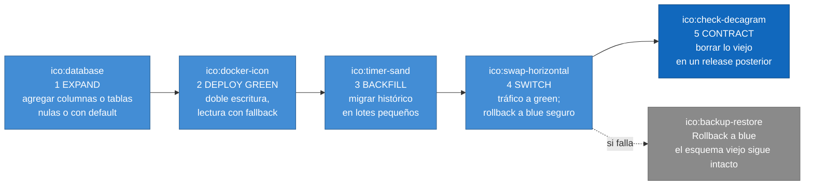

## D4a · Contenedores: módulos, ambientes y estado remoto de Terraform

Pregunta 4. Tipo: Contenedores. Ambientes reales: **stage + varios de producción, sin dev**.

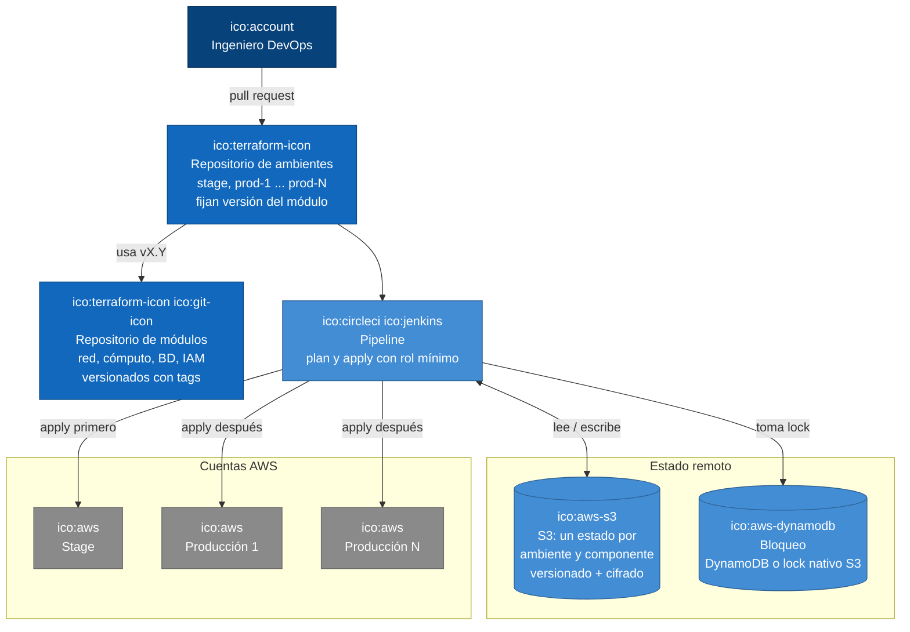

## D4b · Dinámico: promoción de un cambio de infraestructura

Pregunta 4. Tipo: Dinámico.

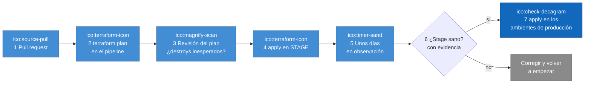

## D5a · Dinámico: build once, deploy anywhere (.NET)

Pregunta 5. Tipo: Dinámico. Así era en **Bizagi y en MercadoLibre**.

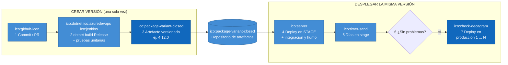

## D5b · Contenedores: despliegue sin tiempo de inactividad

Pregunta 5. Tipo: Contenedores.

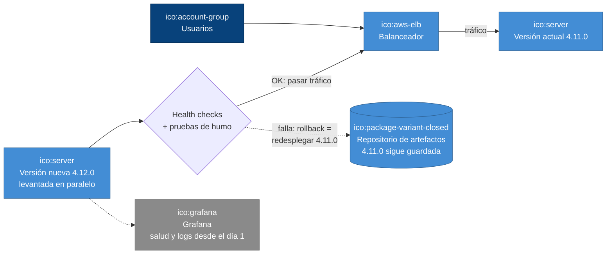

## D6a · Componentes: construcción de una imagen endurecida

Pregunta 6. Tipo: Componentes.

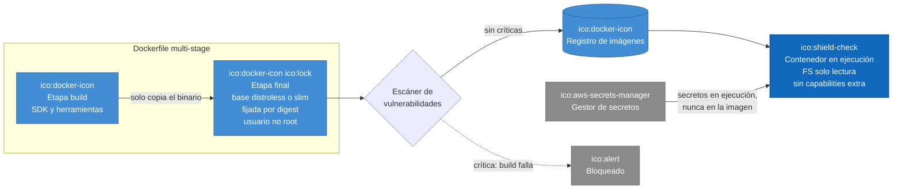

## D6b · Componentes: límites de recursos y alertas de capacidad

Pregunta 6. Tipo: Componentes. Lo de las alertas lo construí en MercadoLibre.

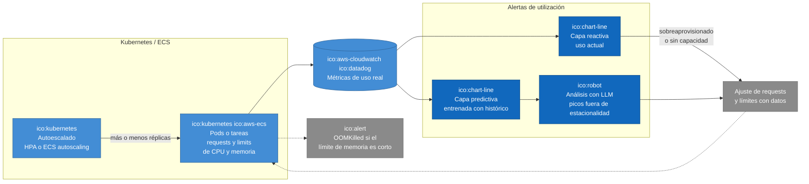

## D7a · Contenedores: un clúster ECS con los dos tipos de lanzamiento

Pregunta 7. Tipo: Contenedores.

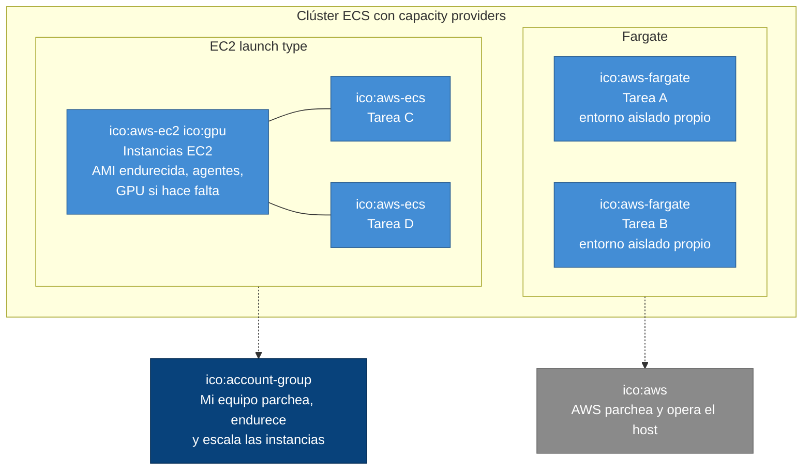

## D7b · Dinámico: árbol de decisión EC2 vs Fargate

Pregunta 7. Tipo: Dinámico (decisión).

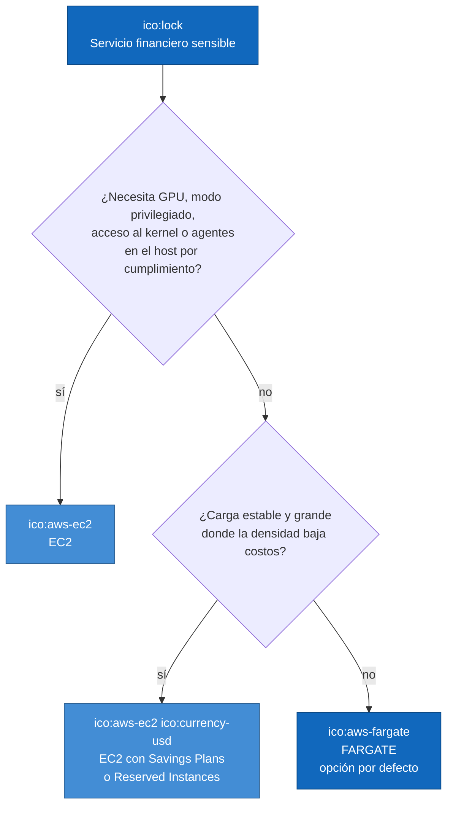

## D8 · Despliegue: VPC en tres zonas de disponibilidad

Pregunta 8. Tipo: Despliegue.

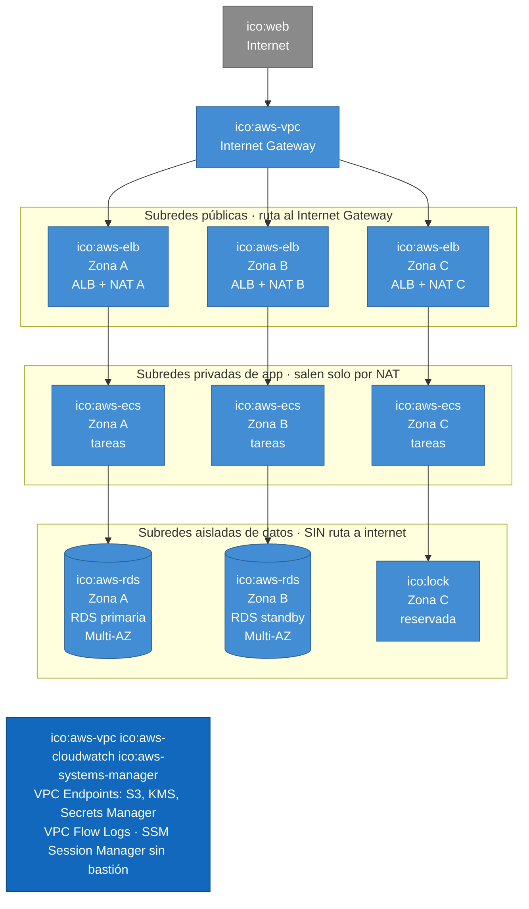

## D9 · Contenedores: cadena de security groups

Pregunta 9. Tipo: Contenedores. Cada salto solo acepta tráfico del security group anterior.

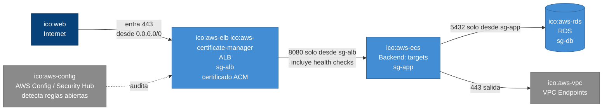
